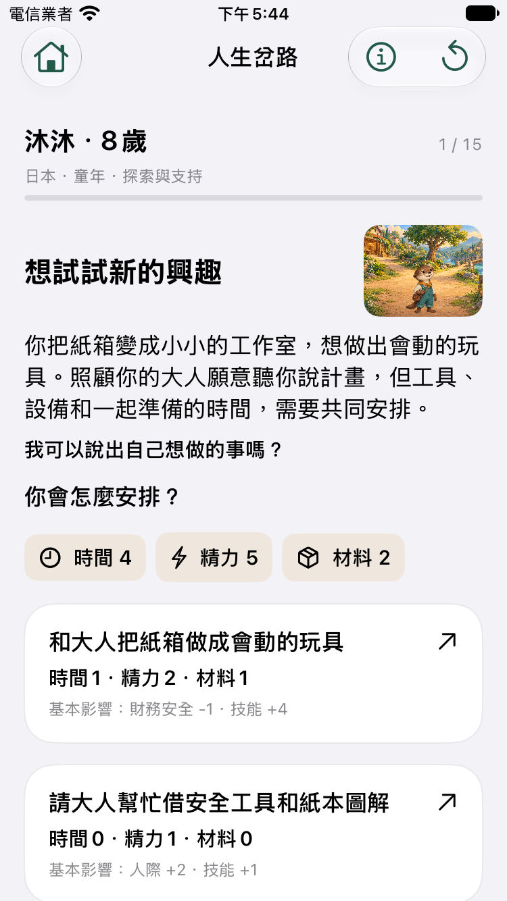
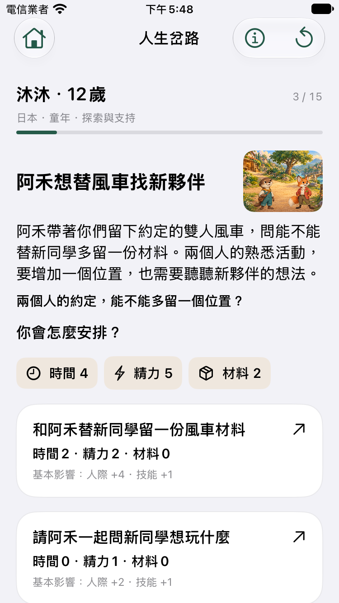
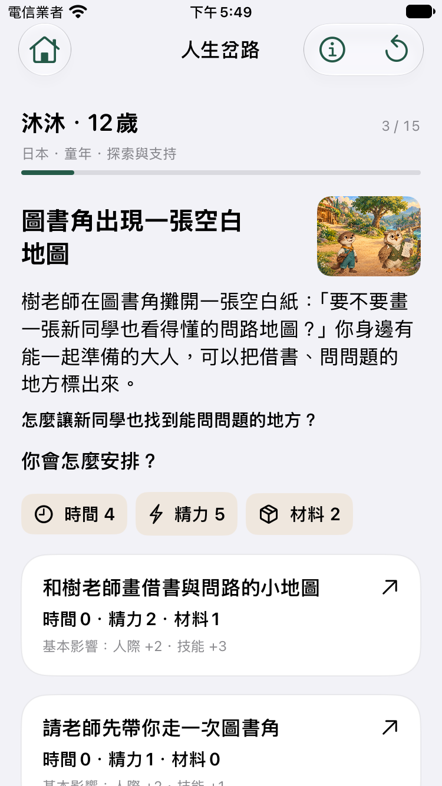

# 條件事件與 Event-first 整合切片

基準：PR #2 的第二輪修正後，使用者於 2026-10-23 授權獨立切片。原 PR #1／#2 維持 HOLD；本片不合併或發布。

## 範圍與驗收契約

這次把完整人生的事件來源與畫面整合：一局仍是五個人生階段、15 個決策槽，由純 Swift 引擎從符合條件的事件中選取；畫面以當前事件與可選行動為主，人物、家庭、原因、比較與歷史為可回看的資訊。所有畫面使用同一個 `LifeSession`，不建立另一套正式 App 或原型人生狀態。

八國、16 家庭、50～70 個原創事件仍為 P1 最終目標。本片增加有界事件池，不宣稱達到完整內容量；目前可玩國家仍為日本、美國、印度、肯亞。既有兩種家庭模板、數位與離線學習區分、國家人口背景資訊與實際原因說明必須保留。

驗收要求：

1. 15 個決策槽涵蓋童年、青少年、青年、中年及晚年；每局結束於 80 歲回顧，這個年齡是遊戲收束而不是死亡預測。
2. 同日本／家庭一，預先固定 Seed 0、1、2 與相同選擇策略，三局兩兩出現不同的實際事件。不能在看到結果後挑選好看的 Seed。
3. 相同背景、Seed、選擇與版本重現完整人生；每次選取保留候選、條件、亂數鍵與被選事件。候選排列變動不得改變結果，不符合條件的事件不可被抽中。
4. 三條已存在的故事分岔仍成立；不可用選項由決策引擎拒絕，並保留可用的免費休息／恢復路線。
5. Event-first 使用正式引擎輸出；後果、原因與比較不使用舊原型的示範數字或預寫結果。小螢幕與最大字級另留 UI 證據。

## CLI：三局故事樣本

執行：

```sh
swift run -c release life-demo --story-samples
```

成功時輸出單一 JSON 文件；錯誤訊息寫入標準錯誤，並以非零狀態結束。既有 `--json` 繼續輸出 `comparison` 與 `skeletonRuns`，四國八家庭的完整人生改由 `LifeSession` 推進，不再把事件池的每一筆資料都當作必經關卡。

三局固定條件：`countryCode=JPN`、`householdID=jpn-1`、相同引擎／資料／內容版本。各局採同一策略：有可用的 `invest` 就選它，其次 `ask`、`rest`，最後才是事件提供的第一個可用選項。相同策略不代表每局必定提交相同選項；符合條件的事件與可用行動不同時，策略會依同一規則應對。

JSON 記錄：

- 頂層：輸出格式版本、三種模型版本、背景、策略、事件池筆數、三局及三組兩兩比較。
- 每一步：年齡、階段、實際 event ID／標題／完整敘事／人物／故事變體、提交的 choice ID／標題、當時提供的選項及可用性／成本／不可用原因。
- `selectionTrace`：實際選取候選、條件評估、亂數與選中結果；`consequenceTrace`：提交選擇後的實際成本、狀態、後果與來源依據。兩者分別回答「為何遇到這件事」及「這次選擇造成了什麼」。
- `finalSummary`：結束狀態、年齡、決策數、走過的階段、資源、已觸發及尚未觸發的故事呼應。
- `verification`：同 Seed／策略重新執行、依已記錄選擇逐步重播、第 7 次選擇後 JSON 存讀再續玩，三者均比較完整 `LifeSession` 與逐步輸出，完全相同才寫入成功。
- `pairwiseComparisons`：Seed 0／1、0／2、1／2 的不同實際事件及其標題／人物。任一組沒有事件差異，或重現核驗不成立，整個命令失敗；不只是輸出 `false` 後仍宣稱成功。

閱讀三局時，先比同年齡位置的事件與人物，再看選項是否不同、為何可用、最後採取什麼行動。資源數字不同本身不足以證明故事變化；相同事件下的後果差異應另讀 `consequenceTrace`，不能混算為事件種類增加。

這個 CLI 是可重現的程式與內容樣本檢查，不是完整的無限情境證明，也不是孩子覺得好玩的證據。策略偏好投入，不涵蓋所有行動；其他選擇、條件上下界及無死局依專門的 Domain 測試驗證。

## 本片事件池與實際三局

實際契約為 catalog schema `3`、引擎 `lc02-4`、內容 `lc02-story-4`、資料 `lc01-data-2`。事件池共 23 筆，單局仍是 15 個年齡槽。12、21、32、59、65 歲可有多個符合條件的候選；另外 10 個年齡槽保留既有事件，讓三條長期分岔的前期決策與後續回應仍可到達。候選按 event ID 排序後均等抽取；無條件預備情境也在候選池內，不是只有全部條件失敗才出現。

新增 8 筆情境分別是圖書角地圖、風車新夥伴、社區修理桌、共煮表、週末市集、花圃輪值、互助桌與回憶錄音機。它們依已執行歷史、健康／財務／技能／人際或家庭支持安排進入候選；行動包含學習、分享與工作，不只改標題。這些條件與成本仍是遊戲假設，不是從國家資料推導的真實生活機率。

以下是預定 Seed 的實際執行結果，沒有換 Seed 挑選樣本。完整 15 步的敘事、行動與原因見 [三局機讀紀錄](../artifacts/evidence/conditional-event-first/story-samples.json)。

| 年齡 | Seed 0 | Seed 1 | Seed 2 |
|---|---|---|---|
| 12 | 阿禾的風車新夥伴 | 阿禾的風車新夥伴 | 樹老師的圖書角地圖 |
| 21 | 樹老師的修理桌 | 樹老師的修理桌 | 樹老師的修理桌 |
| 32 | 舊同事帶來工作變化 | 舊同事帶來工作變化 | 舊同事帶來工作變化 |
| 59 | 小澄邀請花圃輪值 | 小澄邀請花圃輪值 | 和小澄調整生活節奏 |
| 65 | 與樹老師錄下回憶 | 與年輕夥伴整理經驗 | 與樹老師錄下回憶 |

三局兩兩的不同實際事件數：Seed 0／1 是 **1 槽**（65 歲）；0／2 是 **2 槽**（12、59 歲）；1／2 是 **3 槽**（12、59、65 歲）。這證明本片有實際事件差異，不能解讀成每局都是全新人生，尤其 Seed 0／1 的 14 個槽仍是相同事件。孩子是否認為差異足夠、是否願意重玩，仍需試玩；本片不以最小差異自動判定整體遊戲性通過。

三局均到達五階段、15 決策及 80 歲回顧；每局的同 Seed／策略、記錄選擇重播及第 7 步 Codable 續玩均通過完整 session／步驟相等核驗。既有 [四國八家庭輸出](../artifacts/evidence/conditional-event-first/four-country-lives.json) 保留原 JSON 結構，八局皆為 15 決策及 80 歲回顧。這些是 CLI 執行證據；單元測試、UI 及遠端 CI 仍以各自執行收據為準。

## 模型與資料邊界

事件的年齡槽、條件門檻、候選及抽選方式都是明示的遊戲設計，不能當作現實人生事件機率。固定 Seed 是重現工具；國名不得參與成功倍率或事件抽選分支。家庭、資源與過去選擇可影響候選，但不能被敘述成國家或個人的道德價值。

本片不新增統計來源。既有國家背景保留 `lc01-data-2` 的 2023 年網路使用及電力取得人口比例：七國 14 筆 WDI 觀測，資料與授權證據沿用既有來源記錄。國家比例不是沐沐家庭的個人設備機率，也不能用它推測離線學習成本。台灣仍欠同口徑官方資料及授權查核，不填 0、不以其他國家代替；德國、巴西、越南具背景資料不等於本片已完成可玩內容。

事件池擴充需要新的內容／引擎契約；舊版本狀態不得偷偷當作新事件池重播。機讀輸出記錄實際版本；存檔遷移與 SwiftData 自動存檔不屬於本片。

## 保留的三條長期分岔

| 前期選擇 | 後續差異 | 必須保留的檢查 |
|---|---|---|
| 10 歲與阿禾創作或安排碰面 | 72 歲重逢阿禾；其他路線由小澄開啟新的社區連結 | 人物／情境不同；沒有留下這個約定不等於失敗 |
| 13 歲線上、紙本或未製作作品 | 17 歲分別延續不同學習情境 | 過去有作品且技能至少 28 才能帶工作坊；仍可參與或求助 |
| 39 歲共同照顧安排 | 52 歲沿用輪班或第一次尋求支持 | 先前有輪班且健康至少 55 才能接班；免費休息與求助保留 |

這三條分岔與已執行歷史保持關聯；擴充隨機候選不應讓必要的前期決策或後續回應消失。完整「保留原人生、回到重要岔路並重走後半生」仍是 LC-04 後續能力。

## 畫面整合邊界

採 `codex/ui-11-12-choice-feedback` 的事件主導布局、選項卡、選後反應、原因卡與次頁，不採用 `EventFirstFlow` 的兩事件 fixture 索引作正式人生。保留現有五齡沐沐、配角及素材來源記錄；不新增生成美術，也不把早期候選角色整包升格正式資產。

畫面必須先依 `LifeSession.phase` 判定決策、後果或結局；後果與回顧讀取已執行 trace 的事件／人物快照，而非要求 `currentEvent` 在每個階段都有值。選後比較使用選前狀態及同一個 choice ID，不能拿已變動的資源當作原始比較條件。沒有真實人生年份就只顯示年齡，不拿統計年度或原型的 2027／2029 年當作背景事實。

「為何遇到這件事」與「為何有這個後果」分開：抽選候選的隨機性不能自動成為資源變化的原因。未觸發的機會、零值成本調整與未來伏筆不列為已發生的後果。

## 證據狀態

本文件記錄驗收契約及已產出的三局／四國 CLI 證據。單元測試與 UI 檢查結果以本片各自執行收據及後續交付紀錄為準；尚未執行的檢查不得因本文列有要求就算通過。

實機操作、VoiceOver 人工巡覽、10～15 分鐘真人節奏、10～12／13～15 歲的娛樂性與教育理解均另待驗收。Simulator、CLI 或 CI 成功不能替代上述產品證據。

## 本機驗證與截圖

- 純 Swift：58 項通過，包含 1,000 段人生、條件上下界、未入選事件拒絕、排序不變性、版本與序列化防篡改、三條既有分岔。
- Python：7 項通過，涵蓋資料生成與暫存 Simulator 成功／失敗／中止後清理。
- iPhone SE 第三代／iOS 27.0 Simulator：5 項 UI 測試通過，涵蓋完整15步、指定Seed實際事件、最大字級、選後比較的選前快照、無效測試Seed拒絕。Seed 0 的15個UI事件ID與CLI完全一致。
- Release executable、離線資料重建查核、六項基本治理檢查通過。Xcode 既有 AppIntents metadata 警告未新增對應功能；沒有 Swift 編譯錯誤。
- 本次專用裝置已 `simctl delete`，並確認裝置清單不含該UUID；保留原始測試輸出與截圖。沒有刪除共用runtime或原有裝置。

證據入口：[verification.json](../artifacts/evidence/conditional-event-first/verification.json)，其中保留測試命令收據、核心／App提交、測過的來源檔 SHA-256 及未驗收邊界。遠端CI只在push後以最新HEAD確認。

| 事件優先 | Seed 0：阿禾的風車 | Seed 2：圖書角地圖 |
|---|---|---|
|  |  |  |

截圖都是 XCTest 原始 PNG，來源與雜湊見 `screenshot-sources.json`。最大字級採可捲動布局，不宣稱所有行動能在單屏同時出現；人工 VoiceOver、真實 iPhone 與孩子閱讀／重玩測試仍待安排。
