# 原生 Before / After

Before 是固定 PR20 `325b69896553fb6c479e415c0c0991e76ef78a26` 的本輪 Round1；After 為 Round3。所有圖片為 App 原生完整畫面或 XCTest 元素截圖，沒有合成／修圖。Round1、Round2、Round3 的 `source.json`、`screenshots.json`、`test.log` 分別保留來源 SHA、圖片 SHA 與真實保存紀錄。最終判定見 [獨立視覺覆審](FINAL_VISUAL_REVIEW.md)。

每組 Before／After 使用完全相同的 archive、Seed、Choice、家庭與前史。不同列之間的跨國活動只是既有路線見證，並非本片新做的統計或因果比較。

## 13 歲求助

來源：`JPN`／`jpn-1`，Seed `34`，`teen-project` → `ask`。保留筆記本與站姿；移除搶焦圖示。

| SE3 Before | SE3 After |
| --- | --- |
| 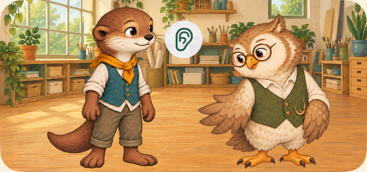 | 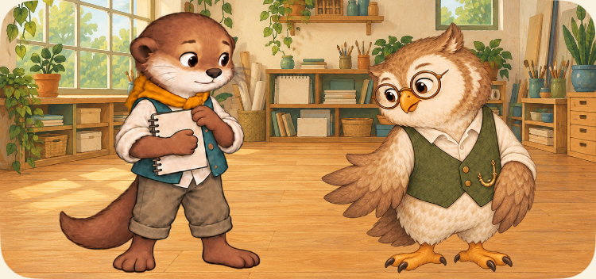 |

[iPhone 17 Before](../../artifacts/evidence/final-polish-loop/round1/iPhone-17/13-ask-normal-screen.png) · [iPhone 17 After](../../artifacts/evidence/final-polish-loop/round3/iPhone-17/13-ask-normal-screen.png)

## 17 歲遠距交流

來源：`JPN`／`jpn-1`，Seed `34`，`teen-direction` → `remoteStudio`。保留已可辨識的螢幕、耳機與遠距老師；不是新重繪。

| SE3 Before | SE3 After |
| --- | --- |
|  | 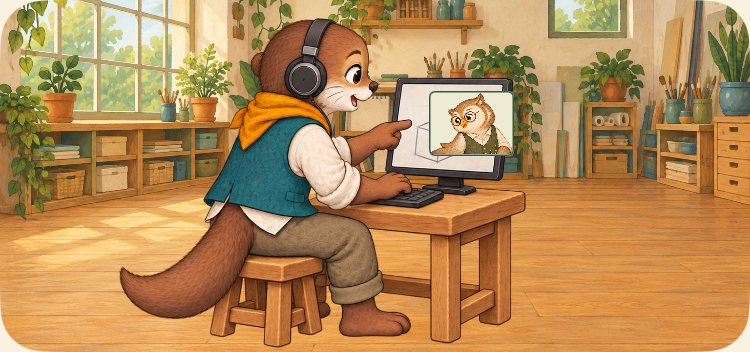 |

[iPhone 17 Before](../../artifacts/evidence/final-polish-loop/round1/iPhone-17/17-remote-normal-screen.png) · [iPhone 17 After](../../artifacts/evidence/final-polish-loop/round3/iPhone-17/17-remote-normal-screen.png)

## 17 歲面對面共作

來源：`KEN`／`ken-1`，Seed `34`，`teen-direction` → `mentorRelay`。保留實際紙本工具與共作；不是新增國家因果證據。

| SE3 Before | SE3 After |
| --- | --- |
|  | 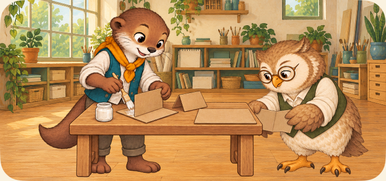 |

[iPhone 17 Before](../../artifacts/evidence/final-polish-loop/round1/iPhone-17/17-collective-normal-screen.png) · [iPhone 17 After](../../artifacts/evidence/final-polish-loop/round3/iPhone-17/17-collective-normal-screen.png)

## 32 歲商量安排

來源：`JPN`／`jpn-1`，Seed `0`，`adult-boundary-calendar` → `ask`。保留坐姿、凳子、紙張與側包；與參與工作區分。

| SE3 Before | SE3 After |
| --- | --- |
| 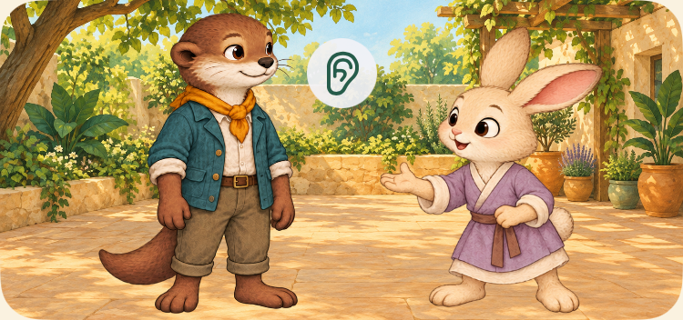 |  |

[iPhone 17 Before](../../artifacts/evidence/final-polish-loop/round1/iPhone-17/32-ask-normal-screen.png) · [iPhone 17 After](../../artifacts/evidence/final-polish-loop/round3/iPhone-17/32-ask-normal-screen.png)

## 32 歲實際參與

來源：`JPN`／`jpn-1`，Seed `0`，`adult-boundary-calendar` → `pacedRole`。保留保存後才出現的工作桌、工具與合作人物。

| SE3 Before | SE3 After |
| --- | --- |
|  | 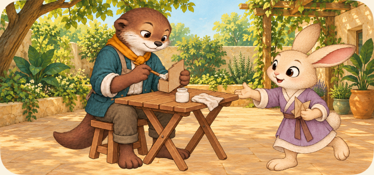 |

[iPhone 17 Before](../../artifacts/evidence/final-polish-loop/round1/iPhone-17/32-participating-normal-screen.png) · [iPhone 17 After](../../artifacts/evidence/final-polish-loop/round3/iPhone-17/32-participating-normal-screen.png)

## 72 歲阿禾重逢

來源：`JPN`／`jpn-1`，Seed `5`，`later-reconnect` → `invest`。保持真實童年狐狸前史，共用人物尺寸與暖紙年代標題。

| SE3 Before | SE3 After |
| --- | --- |
|  | 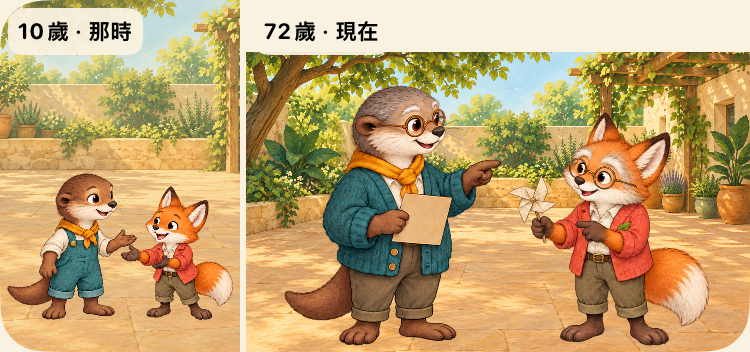 |

[iPhone 17 Before](../../artifacts/evidence/final-polish-loop/round1/iPhone-17/72-ahe-normal-screen.png) · [iPhone 17 After](../../artifacts/evidence/final-polish-loop/round3/iPhone-17/72-ahe-normal-screen.png)

## 72 歲小澄新連結

來源：`JPN`／`jpn-1`，Seed `5`，`later-reconnect` → `invest`。獨處童年使用相同高度上限；不填入童年小澄。

| SE3 Before | SE3 After |
| --- | --- |
| 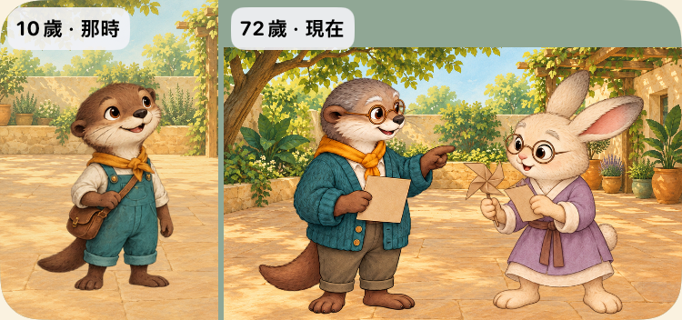 | 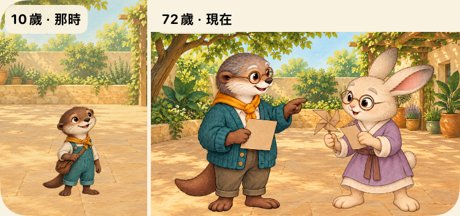 |

[iPhone 17 Before](../../artifacts/evidence/final-polish-loop/round1/iPhone-17/72-neighbor-normal-screen.png) · [iPhone 17 After](../../artifacts/evidence/final-polish-loop/round3/iPhone-17/72-neighbor-normal-screen.png)

## 沒有藏起過渡中的限制

Round2 的 400 ms 全姿勢淡接露出雙手殘影；Round3 依 Critic 建議縮短為 120 ms（700–820 ms）。**這不是連續肢體動畫**，暫停在過渡中仍可能看到重影。額外在 720 ms 後且 820 ms 前停住真正共用 clock，保留該畫面；沒有用已完成的姿勢代替過渡。

| 32 歲 Round2 900 ms 附近 | Round3 真正短過渡中 | Round3 聆聽端點 |
| --- | --- | --- |
| 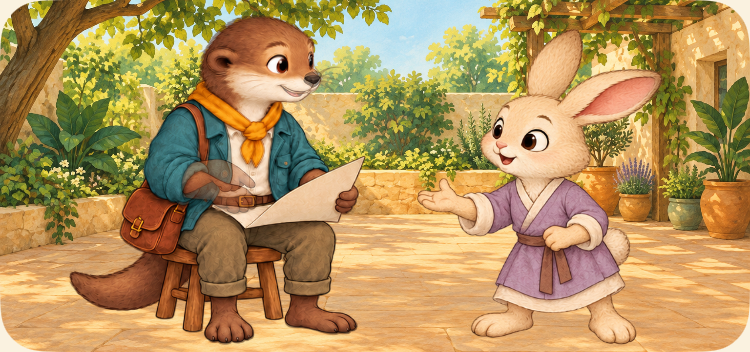 | 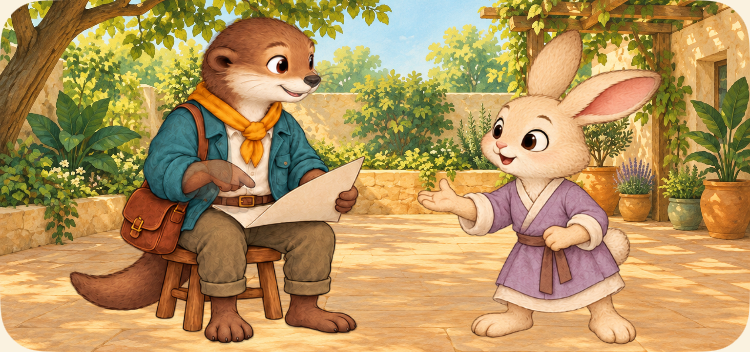 |  |

13 歲也保留 expressing／transition／handoff／listening 四時點，確切毫秒與同一保存 SHA 在 `test.log` 的 `VISUAL_REQUEST`。自然度不得因兩個端點改善就改列全面 PASS。

## 最大字級與 Reduced Motion

| SE3 最大字級 Before | After |
| --- | --- |
| 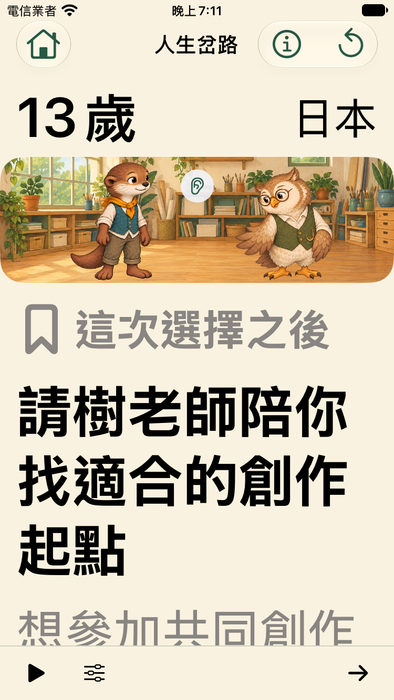 | 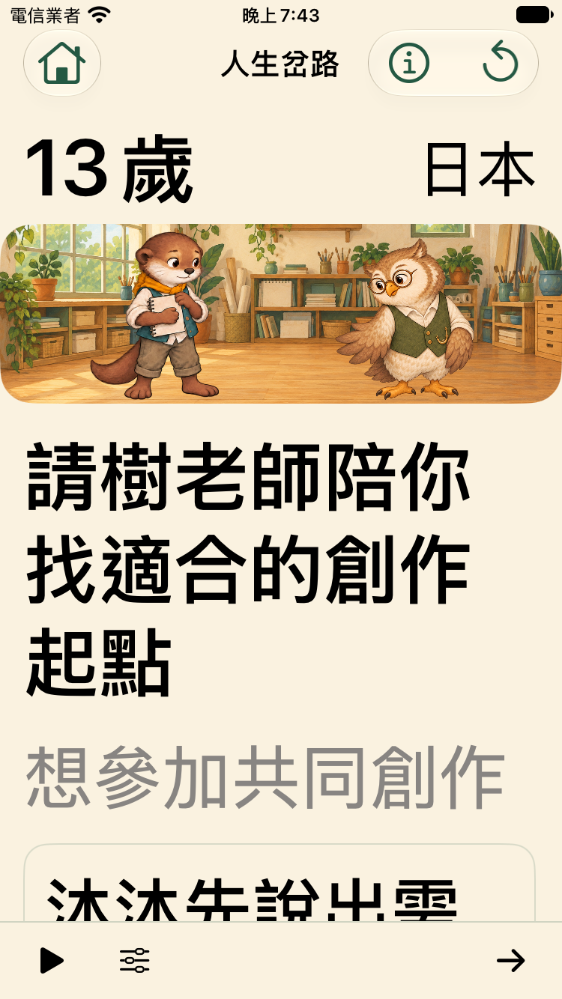 |

移除放大字級下的裝飾標籤，選擇仍完整、可捲動；VoiceOver 的選擇標籤保留「這次選擇之後」語意。主要按鈕可達性由各狀態 `VISUAL_CONTROL` 檢查，不能只看截圖推論。Reduced Motion 保留原提出需求的完整靜態姿勢，不用播放演出才能理解。

[13 歲 Reduced Motion](../../artifacts/evidence/final-polish-loop/round3/iPhone-SE-3rd-generation/13-ask-reduced-screen.png) · [32 歲 Reduced Motion](../../artifacts/evidence/final-polish-loop/round3/iPhone-SE-3rd-generation/32-ask-reduced-screen.png) · [72 歲 Reduced Motion](../../artifacts/evidence/final-polish-loop/round3/iPhone-17/72-neighbor-reduced-screen.png)

正式人類美術選稿、實機 VoiceOver、連續動畫自然度及 10–15 歲理解／娛樂／主動重玩仍需 Owner 試玩。
