# GS-01～03｜生活世界與事件決策浮層

這次可操作的 SwiftUI 原型，把 13 歲阿澄、朋友、照顧者和社區工坊放進同一個生活畫面。玩家選擇後，先在原場景看到支持者、物件與角色心聲改變；再推進到隔天，經過明示省略的年份，看到同一角色 22 歲重訪工坊。

本頁是 `codex/gs-visual-gameplay` 的交付圖庫與操作指南。**世界狀態來自完整的作者示範快照，尚未接入正式人生引擎。** 原因與環境比較也是劇本示意，並非 Domain 計算或 ConsequenceTrace。資料契約見 [fixture-contract.md](fixture-contract.md)，驗收與真人試玩提案見 [acceptance.md](acceptance.md)。

## 建議 review 路徑

1. 在首頁辨認主角、朋友與家人；收起事件看工坊，再展開。收起不會跳過選擇。
2. 選「和小禾一起重做」，先看紙橋與合作反應，再前進到隔天。嘗試暫停、單步與 1×／3× 播放。
3. 走過 2028～2035 的「時光略過」，到 2036 年看成年阿澄與紙橋回憶。打開人生紀錄，應只有三筆已播放片段。
4. 重新開始，選「向工坊老師求助」，比較貓老師、工具清單、隔天的等待與成年回憶。原因與環境比較可隨時返回世界，不必依序讀完才能繼續。

## 真正的原生畫面

下圖皆為本原型的 Simulator 畫面，並非參考遊戲、概念拼貼或 ImageGen 手機 mockup。正文採窄螢幕圖；[標準螢幕圖庫](../../artifacts/gameplay/screenshots/standard/)與[窄螢幕圖庫](../../artifacts/gameplay/screenshots/narrow/)保留完整尺寸。各目錄的 `manifest.json` 將圖片連到測試方法與來源測試包。

### 選擇前：同一個生活起點

| 首頁：主角、朋友與家人同場 | 收起事件，觀察生活場所 |
| --- | --- |
| 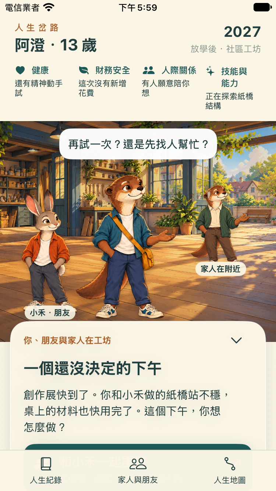 | 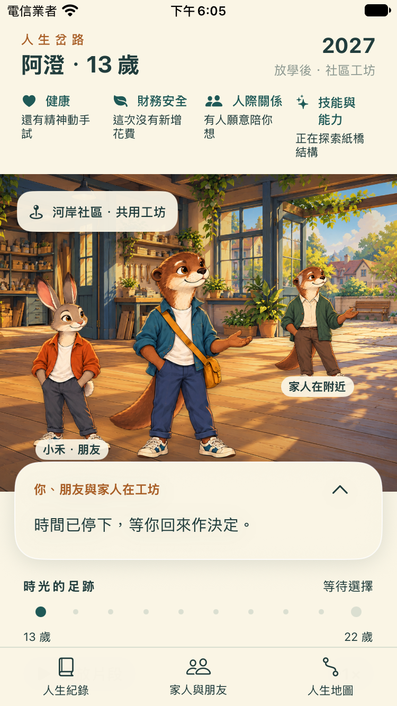 |

四項資源是健康、財務安全、人際關係、技能與能力，使用質性描述。兩條路線共享相同初始條件；這裡沒有自造的人生分數、能力加點或成功率。

### 當日下午：兩個選擇留下不同畫面

| 和小禾一起重做 | 向工坊老師求助 |
| --- | --- |
| 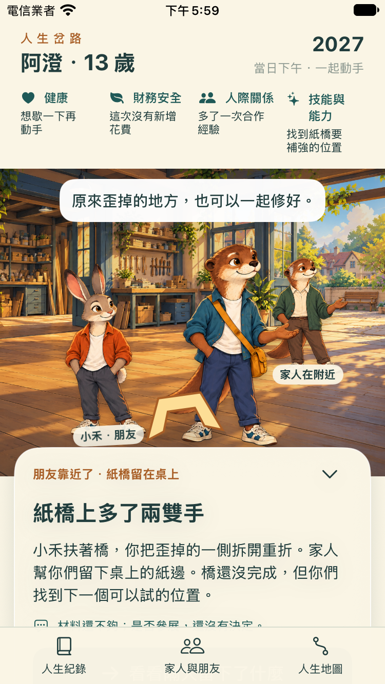 | 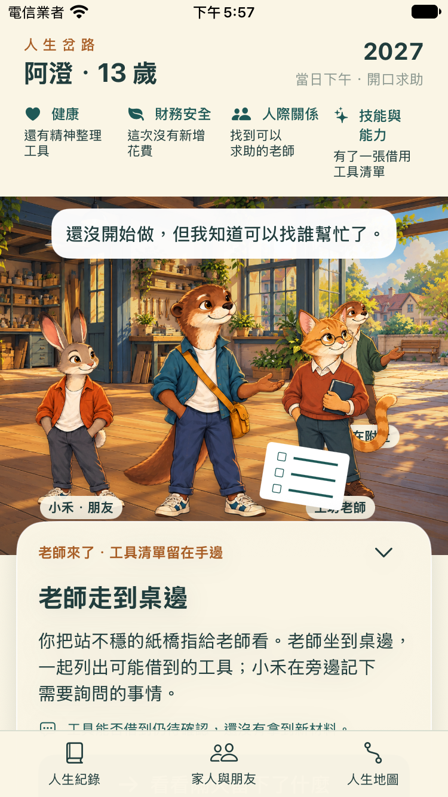 |
| 朋友一起修正紙橋；心聲是「原來歪掉的地方，也可以一起修好。」 | 貓老師加入；心聲是「還沒開始做，但我知道可以找誰幫忙了。」 |

求助路線顯示的是**工具清單**，尚未借到工具或取得新材料；兩條路線也都未宣稱已獲准參展。演出包括人物進場、位置與角度變化、道具出現和文字反應，目前沒有逐格表情或骨架動作動畫。

### 隔天：選擇的痕跡仍在

| 朋友帶來補強紙條 | 照顧者陪同查看清單 |
| --- | --- |
| 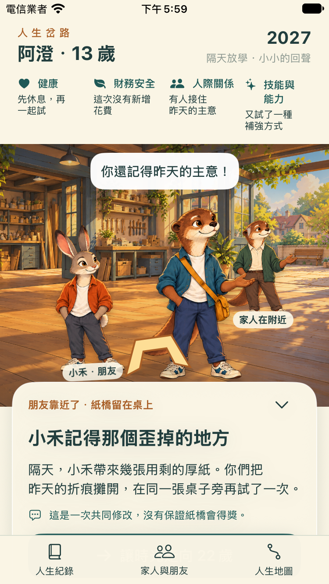 | 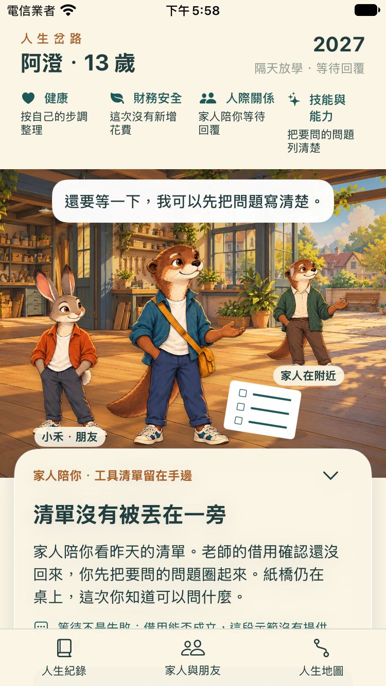 |

人物、道具、資源說明與人生紀錄取自同一路線快照。求助路線隔天不把老師留在現場，也不把待確認的支援寫成已經完成。

### 13 歲到 22 歲：外貌更新，保留本路線回憶

| 成年阿澄與紙橋回憶 | 成年阿澄與工具清單回憶 |
| --- | --- |
| 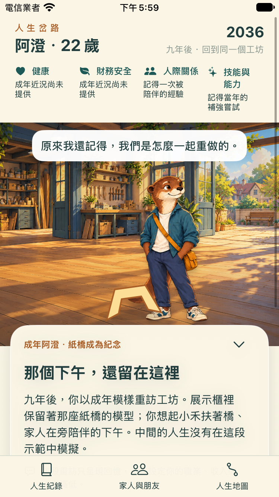 | 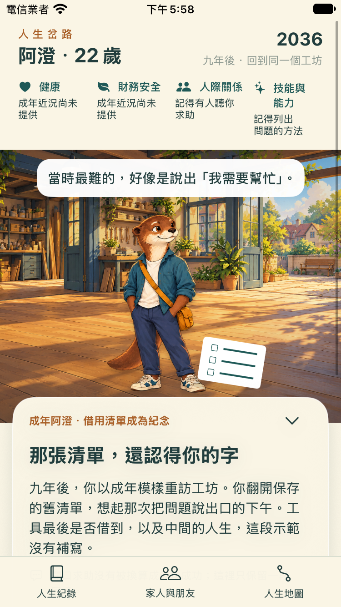 |

阿澄由青少年素材換成同一角色的成年素材，年齡同步變成 22 歲。這個成年片段是另行編寫的回憶，**不是單次選擇造成職涯、收入或人生成功的推論**。成年頁中的支持關係指向回憶，不表示那些人物當下都在場；成年健康與財務狀態沒有資料就保留未知。

| 明示時間跨度 | 已經發生的人生紀錄 |
| --- | --- |
| 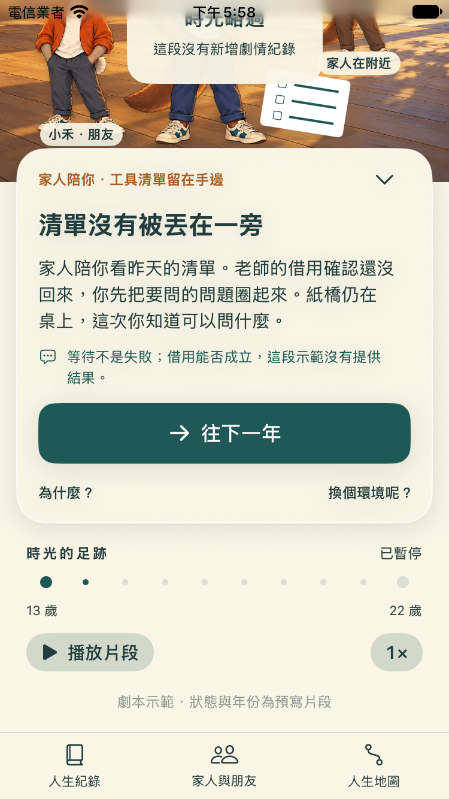 | 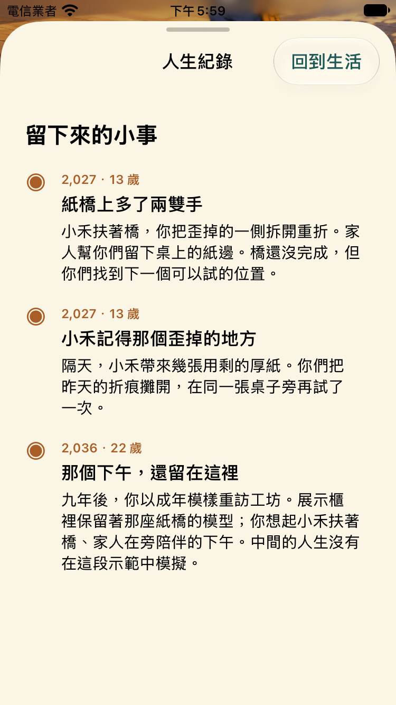 |

2028～2035 的年軸保留「回憶中的 13 歲」場景，不補算未知年份的狀態、不新增事件紀錄。抵達成年片段後先停下，讓玩家看見變化；再按「收藏這段回憶」結束。重新開始才會清除本次路線，回到相同起點。

### 深入查看與可及性

| 可查看內容 | 證據 |
| --- | --- |
| 人物與支持：現場人物與已知關係 | [人物頁](../../artifacts/gameplay/screenshots/narrow/people-and-support.png) |
| 人生地圖：只列已播放節點，未知階段不冒充經歷 | [求助路線地圖](../../artifacts/gameplay/screenshots/narrow/help-life-map.png) |
| 原因：保留事件＋選項配對與示範來源說明 | [合作路線原因](../../artifacts/gameplay/screenshots/narrow/team-reason.png) |
| 環境比較：工坊開放／關閉、交通與支援情境 | [求助路線比較](../../artifacts/gameplay/screenshots/narrow/help-environment-comparison.png) |
| 暫停：年軸與人生紀錄停止前進 | [暫停過場](../../artifacts/gameplay/screenshots/narrow/paused-passage.png) |
| 缺少路線：阻止選擇結果，提供重新開始 | [缺少路線](../../artifacts/gameplay/screenshots/narrow/missing-route.png) |
| 缺少下一片段：保留最後有效場景 | [缺少後續片段](../../artifacts/gameplay/screenshots/narrow/missing-next-beat.png) |

環境比較是與本次選擇配對的虛構情境，尚不是國家統計或跨國因果比較。開啟詳情及 App 進入背景均停止播放，返回後仍保留原時間與路線。

| 最大可及性字級的首頁 | 最大字級下，反應改放文字區 | 比較內容末端可捲到 |
| --- | --- | --- |
| 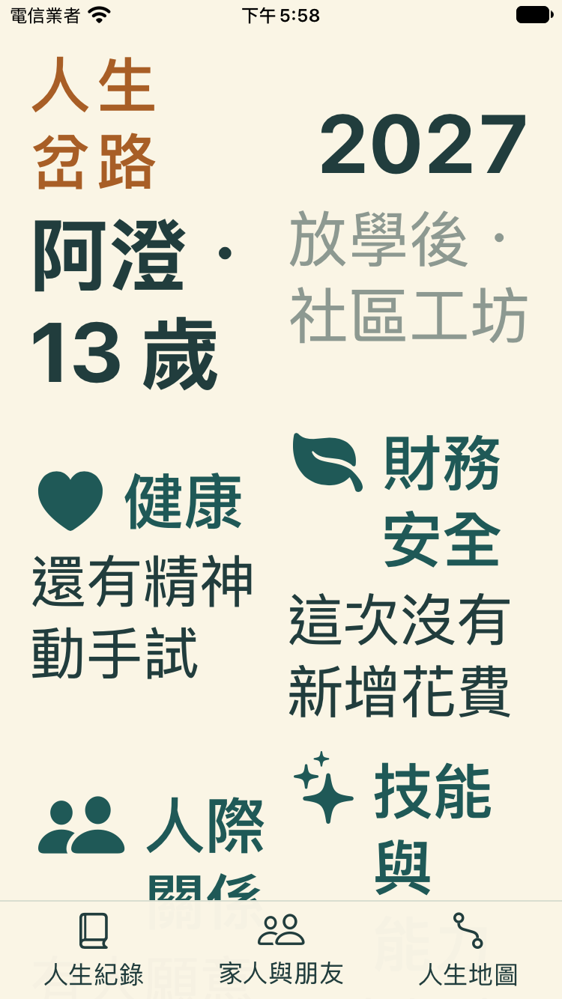 | 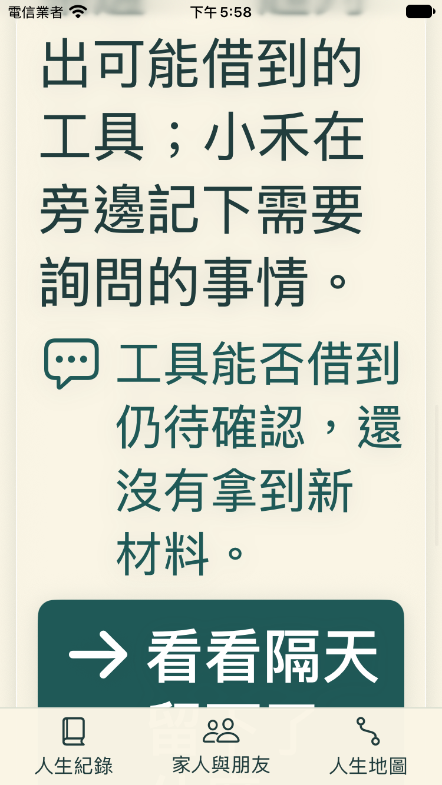 | 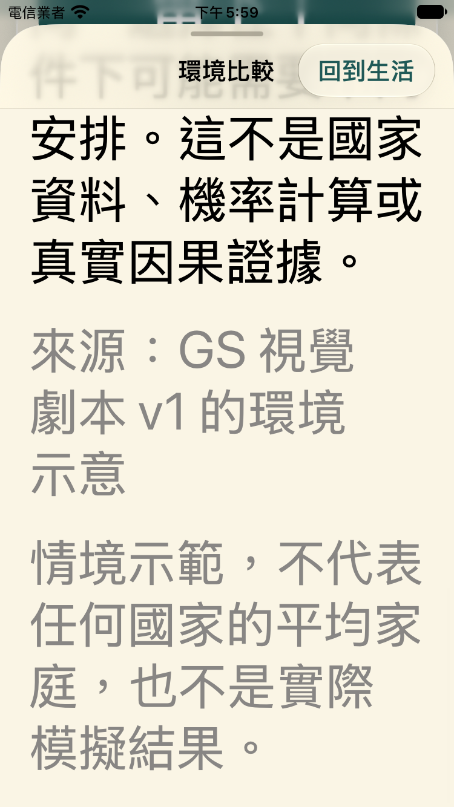 |

資源區在可及性字級改為兩欄，反應移出場景覆蓋區，保留可捲動文字與操作；部分場景裝飾標籤有字級上限。減少動態效果會移除大幅進場位移，但人物、道具與文字仍傳達同一結果。這些畫面與 UI 測試不代替實體手機或 VoiceOver 真人巡覽。

## 執行與 SwiftUI Preview

使用本分支與 repo 既有的 macOS／Xcode 工具鏈。首次 clone 先按 repo Quickstart 完成 setup；檢查腳本會使用 repo 的 `.venv`。

- 開啟 [WorldGameplay.xcodeproj](../../UIPrototype/WorldGameplay.xcodeproj)，選 `WorldGameplay` scheme。
- 在 [WorldGameplayView.swift](../../UIPrototype/WorldGameplay/WorldGameplayView.swift) 開啟 Canvas，可看「生活世界 · 13 歲」與「小螢幕・大字」兩個 Preview。Preview 宣告不是另外一份已執行驗收證據。
- 完整互動與 UI 測試使用下列專用暫存 Simulator runner。`--result-bundle` 必須是尚不存在的路徑；每次重跑換新名稱。

```sh
# 基本治理檢查、Swift 測試、劇本流程、素材 alpha 檢查與 generic Simulator build
bash tools/ui/check-world.sh

# 相同檢查後，執行 WorldGameplay 原生 UI 測試
bash tools/ui/check-world.sh --test \
  --device-type iPhone-17 \
  --result-bundle /tmp/lc-world-review-standard.xcresult

bash tools/ui/check-world.sh --test \
  --device-type iPhone-SE-3rd-generation \
  --result-bundle /tmp/lc-world-review-narrow.xcresult
```

**已記住每次跑完即刪除本次暫存 Simulator 及資料的偏好。** [run-simulator-tests.py](../../tools/ui/run-simulator-tests.py) 只持有自己建立的 UDID，成功、失敗或可處理的中止均經由清理區段先 shutdown、再 `simctl delete`，不是只關機。測試包保存在裝置外；不刪使用者既有裝置、其他任務裝置或共用 runtime。無法執行清理程式的強制終止仍需依日誌中的精確 UDID 補查，不能假稱任何中止都保證已清空。

## 交付範圍與驗證

| 切片 | 本輪可檢視的交付 | 尚未代表的結果 |
| --- | --- | --- |
| GS-01 生活場景 | 工坊背景、阿澄、灰兔朋友、水獺照顧者同場；事件可展開／收起，支援入口可操作。 | 完整生活世界、所有國家場景或正式美術定稿。 |
| GS-02 決策演出 | 同一事件兩種選擇；朋友／貓老師、紙橋／工具清單、質性狀態與後續回憶各自配對。 | 真正人生規則、實際後果 Trace 或跨國因果證明。 |
| GS-03 人生推進 | 暫停、單步、速度切換、明示時間省略、13→22 歲素材切換、三筆紀錄與重新開始。 | 中間九年已模擬、幼年到老年的完整遊戲或全齡動畫。 |
| GS-04 真人遊戲感 | 已備妥 [分組試玩與實機／VoiceOver 提案](acceptance.md)。 | 真人喜好、10～15 歲適齡性、實機操作與 VoiceOver 實際巡覽均未驗證。 |

已有的「四物種 × 五年齡階段＝20 個造型」屬於[上一輪概念素材](../visual/review-gallery.md)。本輪實際接入五個人物圖層：阿澄 13 歲、阿澄 22 歲、朋友、照顧者、貓老師；並未把原本 20 個造型做成全齡演出。

| 證據 | 可以支持的判斷 |
| --- | --- |
| [劇本流程](../../artifacts/gameplay/logs/flow.log) | 15 個情境、68 項斷言通過，涵蓋等待選擇、路線差異、播放控制、跳年界線、成年回憶、重啟與資料缺失。預期值依據先寫的劇本契約。 |
| [Mutation 檢查](../../artifacts/gameplay/flow-mutations.json) | 移除暫停、事件選項配對及年份順序三個保護後，流程檢查都能抓到錯誤。 |
| [最終窄螢幕路線](../../artifacts/gameplay/summaries/narrow-v3.json)／[暫停與缺資料回歸](../../artifacts/gameplay/summaries/narrow-v4.json) | 同一最終來源分兩輪，各3項，合計6個UI方法通過。 |
| [最終標準螢幕路線](../../artifacts/gameplay/summaries/standard-v5.json)／[暫停與缺資料回歸](../../artifacts/gameplay/summaries/standard-v6.json) | 同一最終來源分兩輪，各3項，合計6個UI方法通過。雙尺寸共12個方法／裝置組合、42張原生截圖。 |
| [標準圖庫來源](../../artifacts/gameplay/screenshots/standard/manifest.json)／[窄螢幕圖庫來源](../../artifacts/gameplay/screenshots/narrow/manifest.json) | 每張截圖的測試方法與來源測試包，可追溯版本；截圖本身不代表整個 suite 或真人驗收。 |
| [素材 alpha 檢查](../../artifacts/gameplay/logs/alpha.log) | 角色圖集有真實透明像素；五個實際裁切框各含一個完整可見人物輪廓。 |
| [Simulator 生命週期](../../artifacts/gameplay/logs/simulator-lifecycle.log) | 專用裝置清理工具的測試；各 run 的建立／刪除 UDID 另保留在對應日誌。 |

本輪分層素材由 ImageGen 真實生成，來源、提示、檔案 hash、透明度與人工待驗項見 [素材 manifest](../../assets/gameplay/manifest.json)及[素材說明](../../assets/gameplay/README.md)。目前仍是原型候選，水獺尾部輪廓、角色一致性、適齡與商用帳戶／輸入權利待人工確認；透明度通過不等於美術或授權驗收通過。

接下來應以這一段可操作內容進行畫面 review，再依已提出的 GS-04 方法觀察玩家是否在意角色、期待下一件事及理解兩條路線差異。正式引擎接線、八國完整人生、合併堆疊分支與 App 發布皆不在本頁的完成主張內。

2026-10-23 後續 Visual Loop 的獨立基線 Critic 提出待改善項：小螢幕／大字第一屏的決策入口、人物動作與道具工作平面的可信度、老師／家人名牌局部重疊及角色身份錨。此 checkpoint 的工程測試通過，不代表新 Visual Loop 的美術 Gate 通過；下一分支將修正並重拍。
