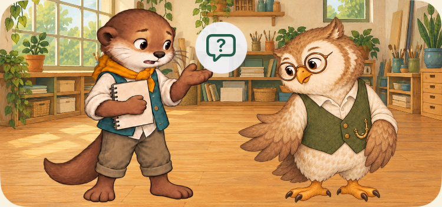
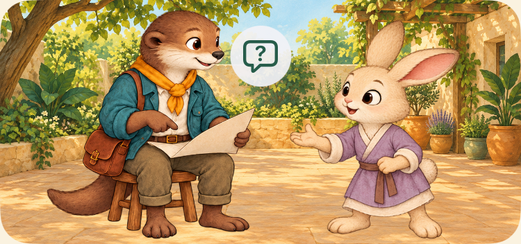
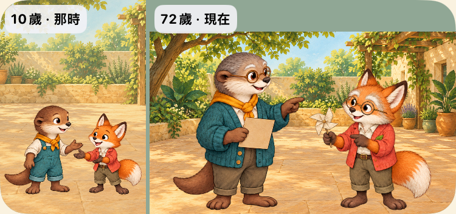

# 原生 Before／After

Before以PR19第三輪原生圖為準；25／45歲是本輪Round1缺陷→修正比較，不能冒稱舊PR19具有同一畫面。圖片沒有後製；場景裁圖由原生XCTest取得。完整SHA與來源在各capture目錄source.json／screenshots.json。正式美術／兒少理解未通過。

| 範圍 | Before | 本輪要看什麼 |
| --- | --- | --- |
| 13歲求助 | `artifacts/evidence/multi-cast-loop/round3/iPhone-SE-3rd-generation/13-ask-normal-scene.png` | 真正ask後表達手勢→放下手聆聽，不是答應幫忙 |
| 32歲求助 | 同目錄`32-ask-normal-scene.png` | 小澄作為接收者，沒有關係增量也不虛構共作 |
| 阿禾重逢 | 同目錄`72-ahe-normal-scene.png` | 童年的沐沐＋阿禾與現在的兩人並列 |
| 小澄新連結 | 同目錄`72-neighbor-normal-scene.png` | 童年獨處與現在的小澄分開，沒有童年小澄 |
| 青年安全邊 | 本輪`round1/iPhone-SE-3rd-generation/25-neutral-normal-scene.png` | 修正新圖頭頂裁切；不是新增一條人生 |
| 中年安全邊 | 本輪`round1/iPhone-SE-3rd-generation/45-neutral-normal-scene.png` | 保留灰鬢、較厚實身形與全頭 |

After場景以 `artifacts/evidence/interaction-memory-loop/final3/` 雙尺寸為準；Round1／Round2及名稱為final的較早候選不是最後成功證據。

| 實際比較 | Before | After |
| --- | --- | --- |
| 13歲提問與聆聽 | [原生圖](../../artifacts/evidence/multi-cast-loop/round3/iPhone-SE-3rd-generation/13-ask-normal-scene.png) | [原生圖](../../artifacts/evidence/interaction-memory-loop/final3/iPhone-SE-3rd-generation/13-ask-normal-scene.png) |
| 32歲說出需要 | [原生圖](../../artifacts/evidence/multi-cast-loop/round3/iPhone-SE-3rd-generation/32-ask-normal-scene.png) | [原生圖](../../artifacts/evidence/interaction-memory-loop/final3/iPhone-SE-3rd-generation/32-ask-normal-scene.png) |
| 童年朋友再相聚 | [原生圖](../../artifacts/evidence/multi-cast-loop/round3/iPhone-SE-3rd-generation/72-ahe-normal-scene.png) | [原生圖](../../artifacts/evidence/interaction-memory-loop/final3/iPhone-SE-3rd-generation/72-ahe-normal-scene.png) |
| 獨處後的新社區連結 | [原生圖](../../artifacts/evidence/multi-cast-loop/round3/iPhone-SE-3rd-generation/72-neighbor-normal-scene.png) | [原生圖](../../artifacts/evidence/interaction-memory-loop/final3/iPhone-SE-3rd-generation/72-neighbor-normal-scene.png) |
| 25歲頭頂安全邊（本輪修正） | [Round1](../../artifacts/evidence/interaction-memory-loop/round1/iPhone-SE-3rd-generation/25-neutral-normal-scene.png) | [修正](../../artifacts/evidence/interaction-memory-loop/final3/iPhone-SE-3rd-generation/25-neutral-normal-scene.png) |
| 45歲頭頂安全邊（本輪修正） | [Round1](../../artifacts/evidence/interaction-memory-loop/round1/iPhone-SE-3rd-generation/45-neutral-normal-scene.png) | [修正](../../artifacts/evidence/interaction-memory-loop/final3/iPhone-SE-3rd-generation/45-neutral-normal-scene.png) |

以下動態兩時點保留final2來源；final3唯一renderer差異為72回憶容器對齊，已由獨立review及SHA重建核對，未改求助或保存演出。

## 真實選擇後的兩個演出時點

### 13歲

### 32歲

這是同一份實際結果的兩個姿勢；沒有另給支持、重抽機會或寫入人生。不是連續起身／肢體動畫，也不能只靠圖示證明對方沒有答應。

## 童年與現在

圖片能看見不同人物歷史；完整因果仍以真實trace及文字解釋核對，沒有聲稱孩子已理解。
