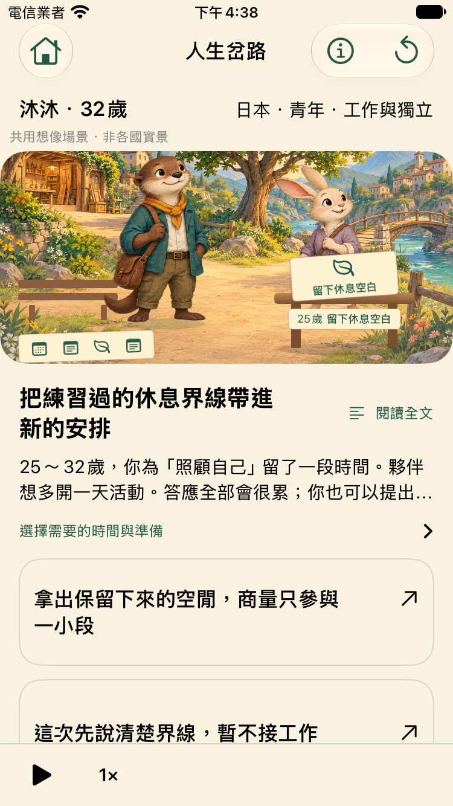
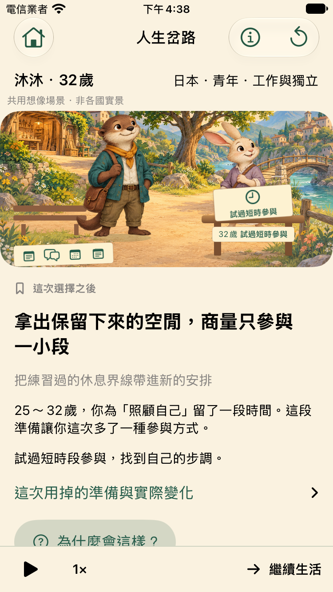

# P1 人生體驗補強：交付與目標對照

2026-10-27，基底PR14 `3177946`，分支`codex/p1-experience-completion`。這次交付可執行程式、52個事件、完整人生量測及獨立覆審。維持獨立Draft／HOLD，沒有合併或發布。

**核心機制已更接近目標；尚不能宣稱整體完成90～95%。** 使用者本輪明確回覆兒少尚未試玩。娛樂、理解與自發重玩是產品必要證據，沒有經使用者採納的權重，也不能任意把這些缺口算成最後5%。

## 玩家會看見的改變

- 生活重心留下真正走過的時間：例如25～32歲為自己保留時間，32歲多一個「商量只參與一小段」行動。改選重心不重抽眼前事件；重心不再每段自動加點，資源改變來自實際事件選擇。
- 除了既有13→17→25創作鏈，同一個工具練習或照顧願望，會因環境準備負擔及家庭條件，走向不同的可行路線與後來合作。共用資料計算成本／資格，沒有國名成功倍率。
- 說出需要、確認支持、試過短時參與、之後再調整，各有真實記憶。後來再次求助或休息不會抹掉以前已建立的支持及步調，世界中也會留下不同道具標記。
- 40→52個原創事件，仍每局15次重要決策，不為增加事件數而延長強制等待。完整原局、分岔後半生、同背景重播與存檔繼續保留。

## 與原始目標逐項對照

| 目標 | 本版判定 | 可核對證據／剩餘缺口 |
| --- | --- | --- |
| 出生未知，不能先決定出身 | 機制符合 | 主入口抽16個示範家庭，探索才手選；不宣稱全球新生兒權重。 |
| 八國、16家庭、五階段完整人生、50～70事件 | 程式與內容量符合 | 52唯一事件，1024局各15決策、全事件可達。家庭仍是虛構模板，不能代表各國典型人生。 |
| 相同願望，不同環境有不同路線 | 三組機制符合，資料仍部分 | 創作、照顧、離線工具有實際可行行動與後續差異；七國可比輸入、台灣缺值保留unknown，不編造個人因果。 |
| 同家庭比較公平 | 工程符合 | 預設模板配對，量測比對全部家庭實際條件；進階混合家庭仍明示，不能把混合比較當純國家效果。 |
| 選擇多年後改變人物／機會 | 工程符合，體驗待驗 | 真實story facts與完成的focus區間驅動後續；後果說明可回溯。求助／休息不是沒故事，但延續普遍性仍需試玩。 |
| 原人生不改寫、回到岔路完整走後半生 | 工程符合 | 原局bytes、完整分岔、固定Seed、存讀、真實寫檔失敗與重試都有回歸；不把後來的所有變化歸因一次改選。 |
| 每次不同且值得再玩 | 多樣性符合，重玩待驗 | 64個同家庭／策略組，各16 Seed的差異中位7～9.5／15；這是事件ID差異，沒有真人自發第二局證據。 |
| 生活重心可主動經營 | 本版機制符合 | 四重心各有前因與可行延續，不再每段自動增加資源；機會出現不代表已接受或成功。 |
| 世界看得見後果，不像問卷 | 部分符合 | 角色場景常駐、支持／恢復／工具道具反映實際記錄；小螢幕實圖已看。共用寓言場景、整張PNG、自然角色表演仍有限，未冒稱正式美術。 |
| 10～15分鐘、兒少娛樂與啟發、無障礙 | 尚未驗收 | 使用者確認尚未試玩；保留分10～12／13～15歲、實機、人工VoiceOver、未受提示重玩、自己的話解釋環境與選擇的驗收。 |

## 驗證與獨立覆審

精確日誌、原生測試批次及來源綁定見[validation.json](../artifacts/evidence/p1-experience/validation.json)；量測方法、策略與不利結果見[新舊量測](../artifacts/evidence/p1-experience/comparison.md)。最終完整release Swift 140項、Python 40項、basic 6項通過；最新focus2 SE為2/2，零skip及publication警告。先前debug中止與過時+1預期失敗保留，不冒稱通過。遠端CI在推送後核對當前HEAD。

[獨立覆審全文](../artifacts/evidence/p1-experience/independent-review.md)已綁定實作`28aa189`的106個來源檔，沒有缺少或不符。獨立Agent曾找出無前因敘事、購買計畫誤當老師支持、後續求助／休息覆蓋已確認記憶三類P2，均修正並補反例。最終核心覆審沒有未解P1/P2；獨立驗證含23定向測試與41不變式斷言。這是核心工程接受，沒有解除產品HOLD。

本輪所有本機Simulator均由`ios-check.sh`建立專用裝置、保留結果後`simctl delete`；沒有刪除其他任務裝置或共用runtime。原生證據區分各版本分批結果，不把不同輪次相加冒稱單輪全過。

## 相容性與CI

新引擎`p1-experience-1`、內容`p1-experience-story-1`、生活重心`life-focus-2`。舊規則存檔拒絕載入且保留原檔，**沒有自動遷移**；從新人生開始體驗本版。這項取捨有版本反例測試，不能悄悄用新規則重算舊人生。

PR14基線CI #47（40467129913）不是全綠：Swift／basic／advisory成功，一個UI shard成功，另兩個45分鐘取消，aggregate失敗。下載其中一個取消shard的原始artifact後，看到前7例通過，完整分岔單例耗時921秒，取消時另一個完整分岔仍在逐項檢查。這不等於證明所有慢測試沒有其他問題。

本輪從3改6個UI shard，45分鐘上限不變、全部案例恰執行一次、無跳過、聚合gate不變；增加inventory回歸與CI 128局新規則抽樣。新的完整1024局證據隨PR提供。最終HEAD遠端CI仍須另外核對。

## 下一次驗收

先自由玩完整一局，觀察是否自行開始第二局；之後才引導同家庭跨國比較及回到岔路。既有[主持步驟與空白表](opportunity-playtest.md)已補本版操作。不要先告知孩子預期答案，也不要用測試策略當成建議的正確人生。

本版可以作為新的工程試玩候選；完整資料、正式美術、實機VoiceOver及兒少娛樂／啟發Gate仍開放。沒有上架或合併授權。

## 遠端CI第一輪與測試同步修正

PR15 `1b8f5b3` 的CI #48（40478935963）：引擎140、Python40、basic及advisory成功；原生29/30，一項讀取重心收據失敗。完整xcresult/AX顯示冷啟後播放未暫停，XCTest送點擊時跨過生活蒙太奇，已到12歲並有額外選擇；引擎tick沒有自行choose。獨立Reviewer支持先修測試同步，沒有把這次失敗判成存檔毀損或新增模型缺陷。

修正僅在既有UI案例：重開後明確暫停、等待／略過蒙太奇，確認10歲、child-friend及恰一段選擇，再開同一收據，讀前後archive checksum不變；沒有刪除或放寬原斷言。測試SHA及原始失敗在[ci-sync/correction.json](../artifacts/evidence/p1-experience/ci-sync/correction.json)，定向標準機1/1與SE1/1分批通過，兩台當次Simulator均delete。這些本機使用iOS27，原CI使用iOS18.5，不能代替新HEAD CI。

產品程式、資料及模型版本不變，原140／1024證據仍綁原已審來源；這次單一測試修改另綁SHA。這不是在未查原因下重跑後宣布全部通過；第一輪29/30與錯誤保留，最新遠端結果另核對。
