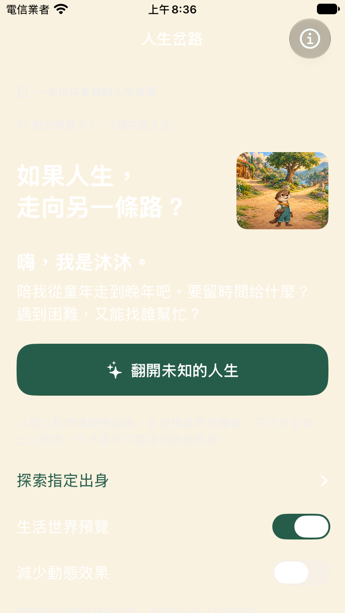
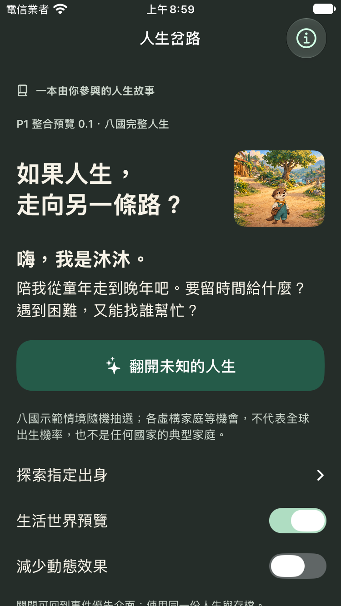
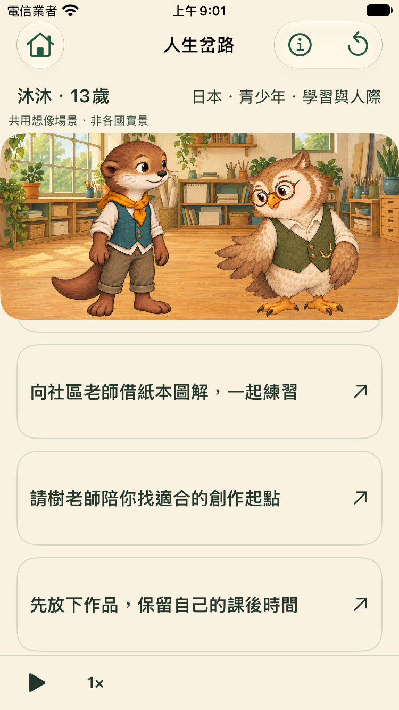
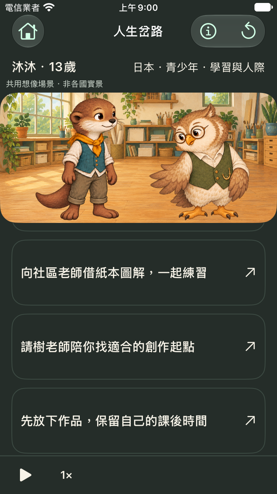
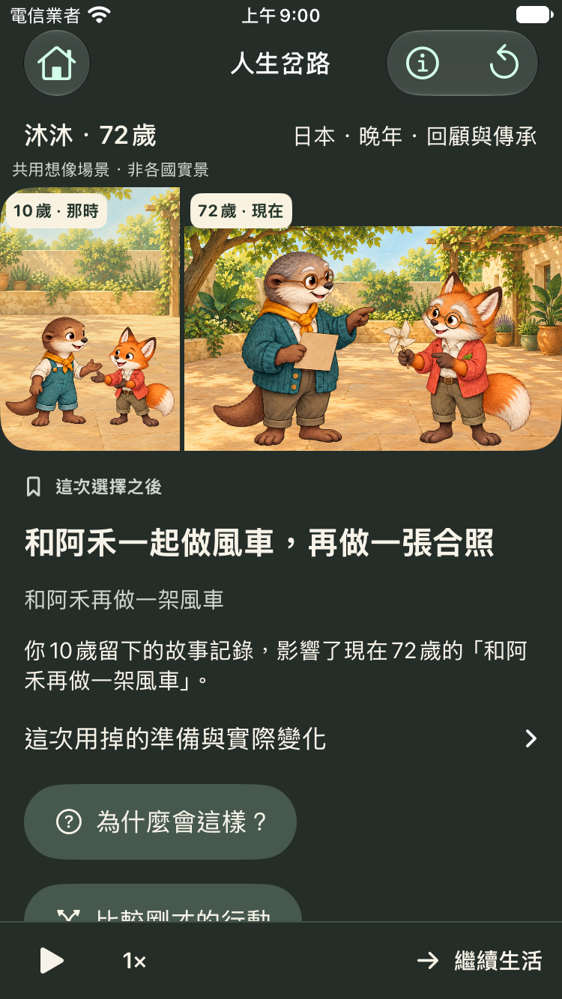
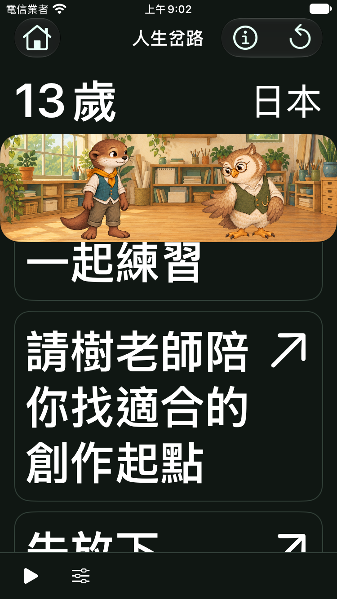

# 字體與背景：原生 Before / After

基準為 PR21 `45d3ff9` 未修改 App，在 iPhone SE3 模擬器開啟系統深色模式。After 是同一版加本輪色票修正，逐檔來源 SHA 見每台 `source.json`；圖片不是設計 mockup。

## 深色模式首頁

原版：白字疊在固定奶油底，出生入口與說明幾乎消失。

修正：暖白主字、淺灰綠次字、深墨綠底；主要按鈕仍為白字配深綠底。

## 13 歲決策，同一份真實存檔

淺色仍保留暖紙繪本色調；深色將文字與底色一起切換，插畫中的淺紙道具維持固定深墨字。

| 淺色 | 深色 |
| --- | --- |
|  |  |

## 晚年回憶與最大字級

10／72 歲年代標籤有不透明淺底及固定深字，不會隨深色模式反白。最大無障礙字級仍需捲動，已把要驗證的選項完整移到可視範圍；不將這點當作閱讀舒適度已通過。

| 72 歲深色回憶 | 最大字級＋提高對比 |
| --- | --- |
|  |  |

完整兩尺寸、三種外觀、七個畫面見 `artifacts/evidence/readability/delivery/`。原生對比工具仍有保留 finding；請與[驗證邊界](VALIDATION.md)一起閱讀，不把這些圖當成全面無障礙認證。
