# RC-00～02：原生操作對照

同一真實引擎存檔：`interaction-fixtures/13-before.json`，JPN／jpn-1／Seed34，未做13歲決定。來源基底PR21 `eb6eff1`＋本片overlay；下方「原本」是同一新build的原選項模式，不冒稱另外執行了乾淨基底binary。各批產品與測試SHA在同目錄`source.json`。

## 原本與滑動卡（SE）

|原本選項模式|滑動卡（四條道路皆保留）|
|---|---|
|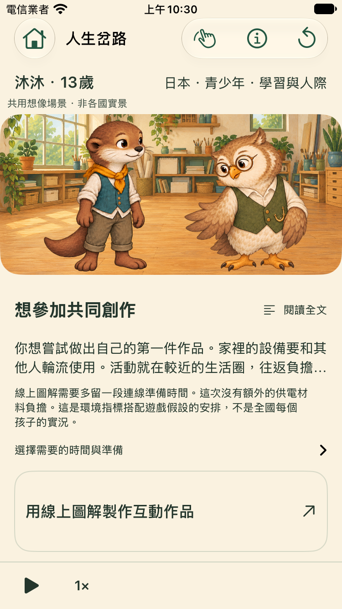|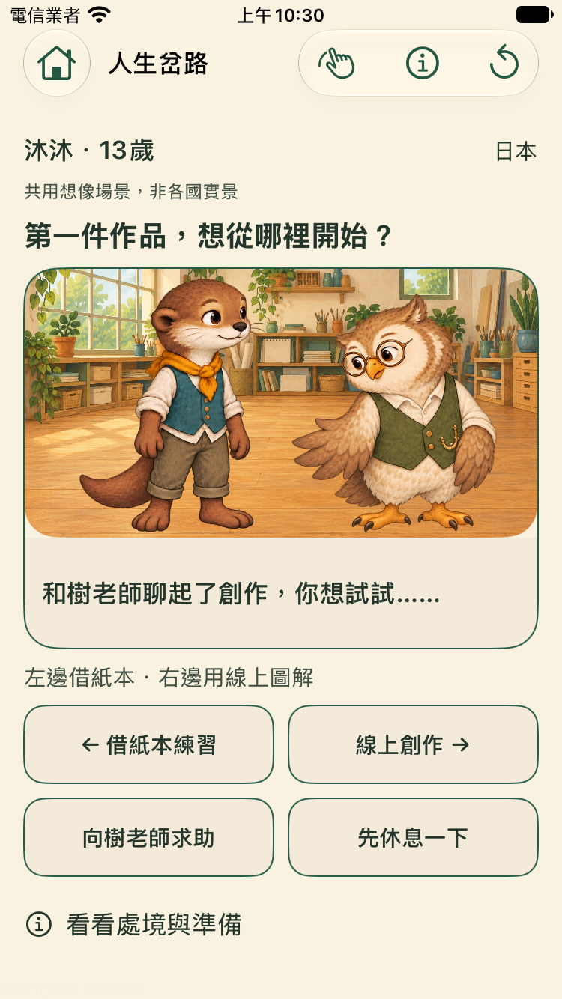|

原本需要在事件區捲動找選項；新卡正常字首屏可見兩個主選擇、求助與休息。這是畫面差異，未量測真人更快／更好玩。最後加強的「左右拖卡」提示見下方final批，未換素材或事件。

## 保存成功才出現活動

|紙本（真實左滑）|線上（真實右滑）|
|---|---|
|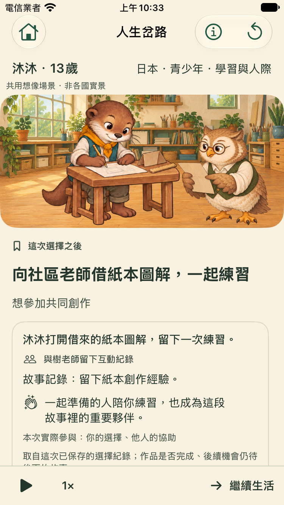|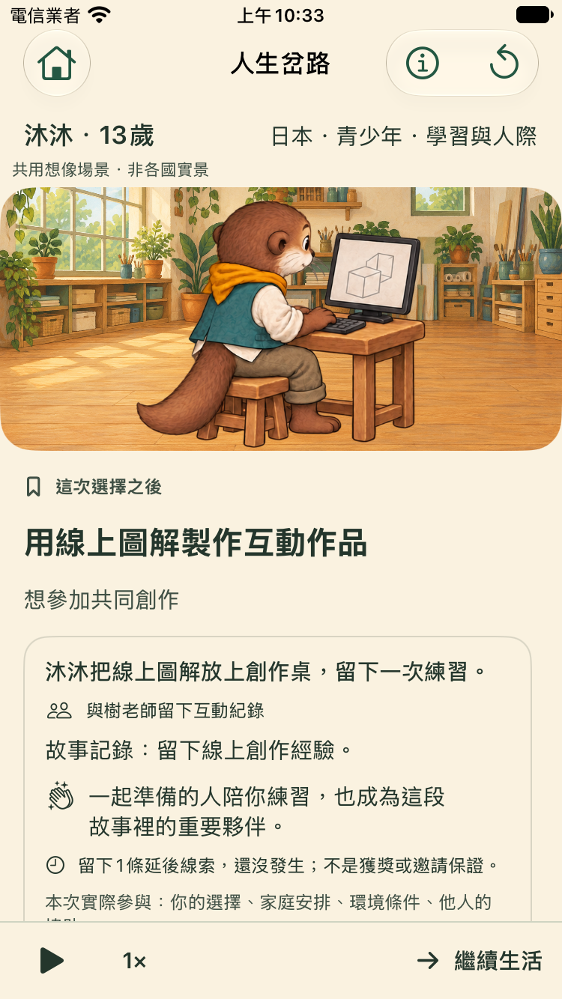|

|求助|休息|
|---|---|
|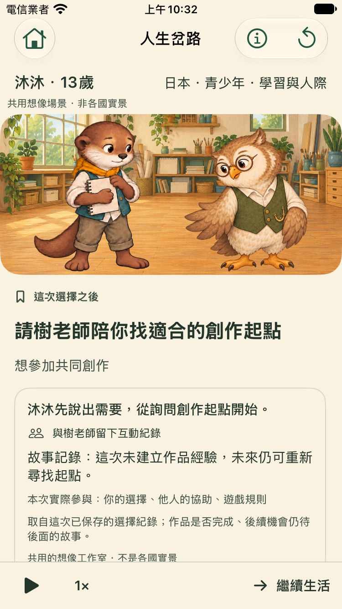|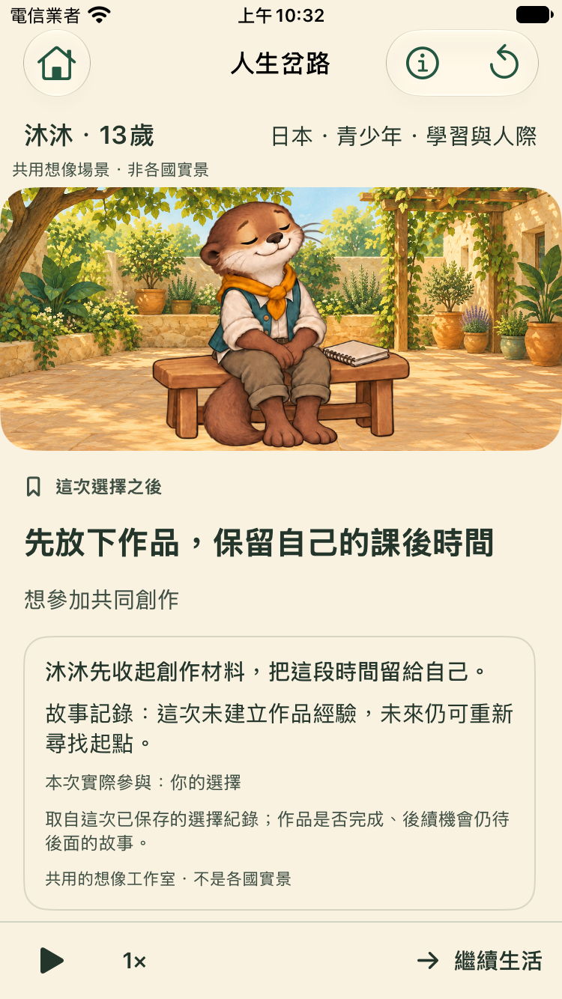|

求助是提出需要與聆聽，未承諾幫助；休息不畫成失敗。所有反應沿用真實保存後的LifeWorldScene投影，沒有新結果圖或成功抽選。

## 保存失敗與可重試

|寫入失敗，卡片與原檔保留|解除一次性注入後重試成功|
|---|---|
|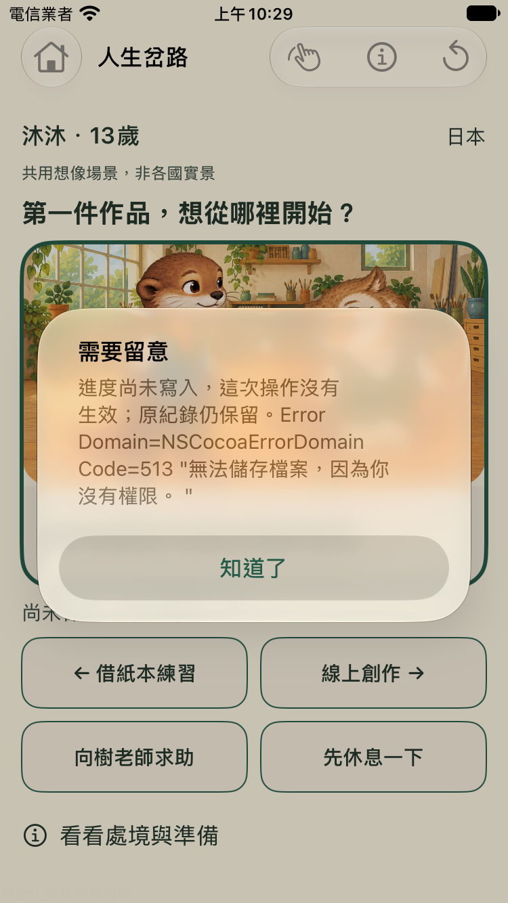||

[35秒原生手勢錄影](../../artifacts/evidence/reigns-card/round2/iPhone-SE-3rd-generation/native-swipe.mp4)：實際XCTest操作包含未達門檻、垂直捲動與左右放開，不是mockup。影片擷取自該測試執行中，完整結果另見test.log。

## 大字／深色／提高對比／Reduce Motion

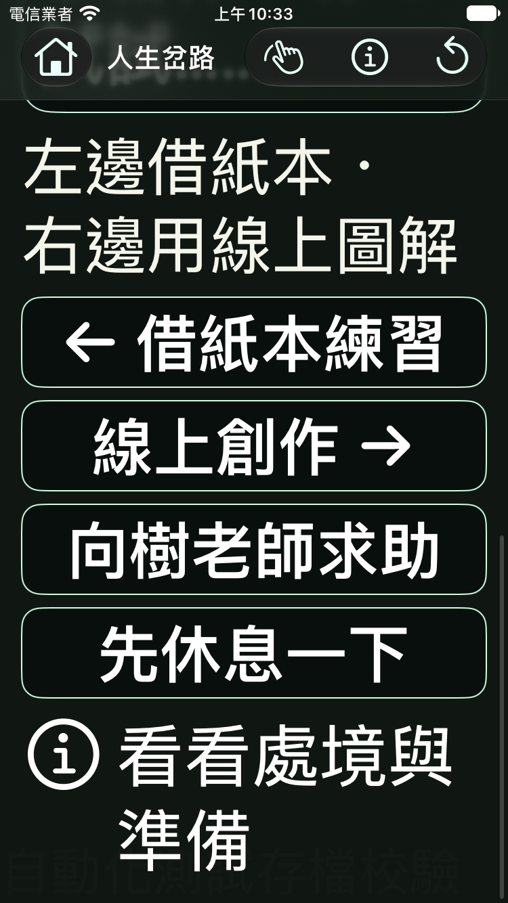

最大字級需捲動，全部四個替代按鈕仍可讀可達；不能宣稱最大字級首屏即可完成決策或真人VoiceOver已驗收。

## 最後提示版（iPhone17）

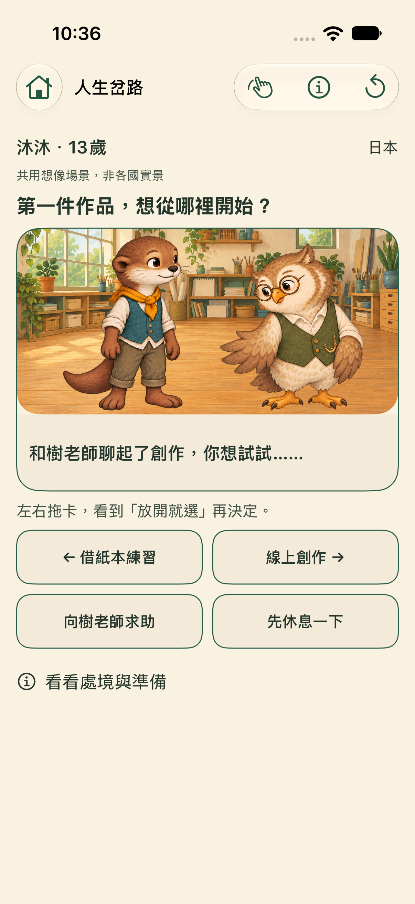

獨立Critic指出原提示沒有明講卡片可拖，最後改為「左右拖卡，看到『放開就選』再決定」。準備入口的44pt與全文sheet再作定向驗證，見VALIDATION。

## 最後修正：準備說明不混淆四種行動

|修正前：求助也被附上設備安排|修正後：只有線上活動使用數位準備說明|
|---|---|
|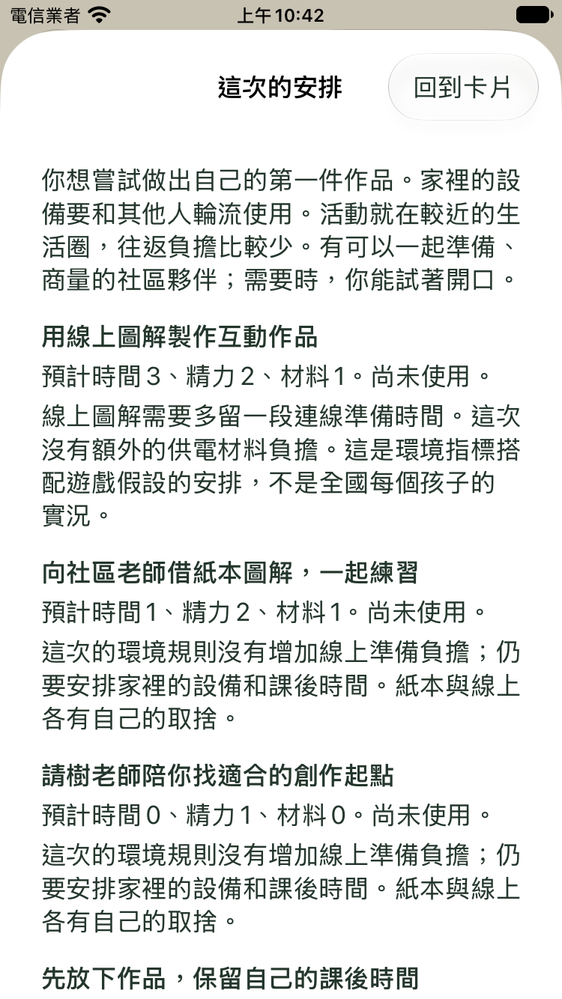|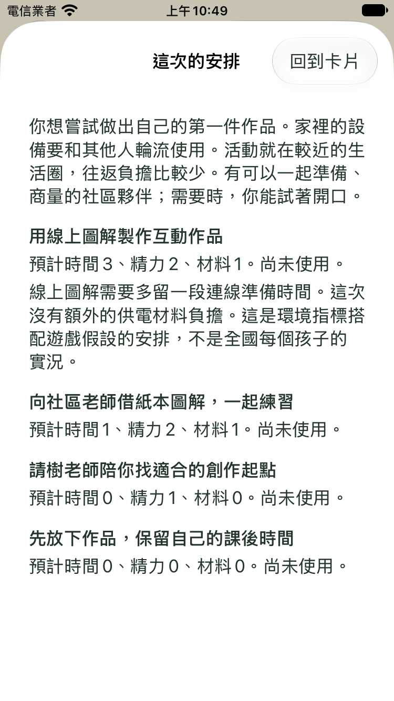|

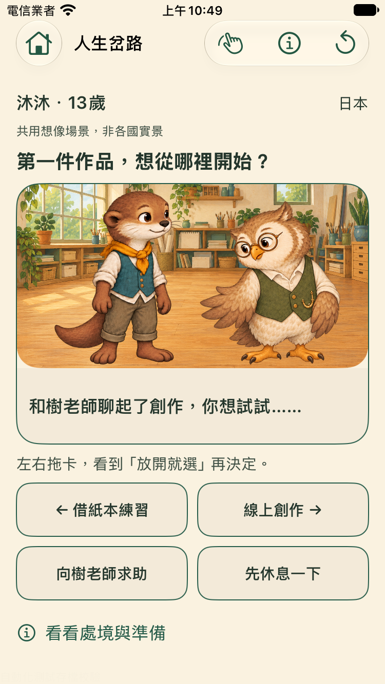

最後兩尺寸的來源SHA與各兩模式定向測試見`details-corrected`；全文、返回及四選項可達均通過。
