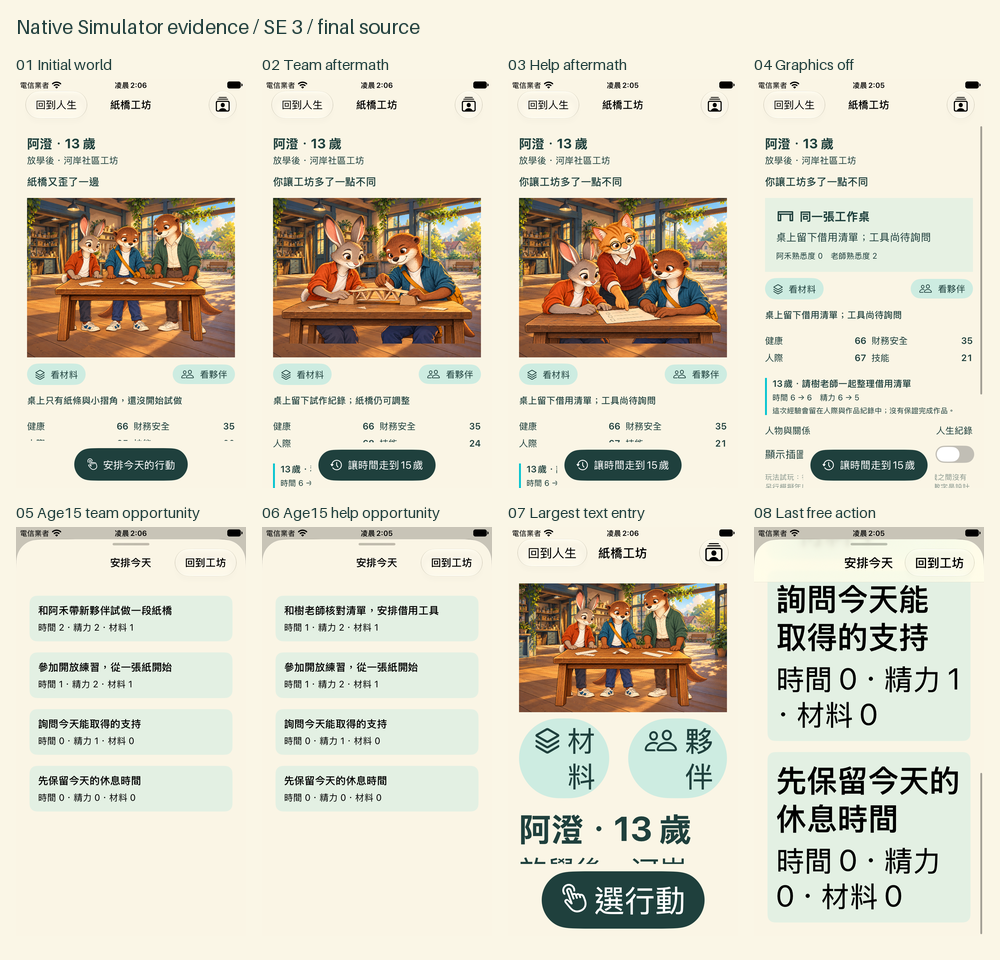
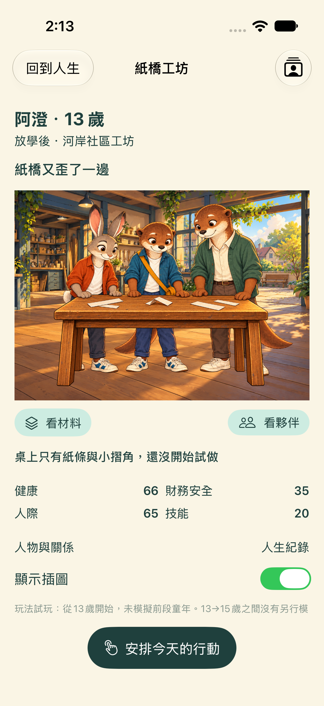
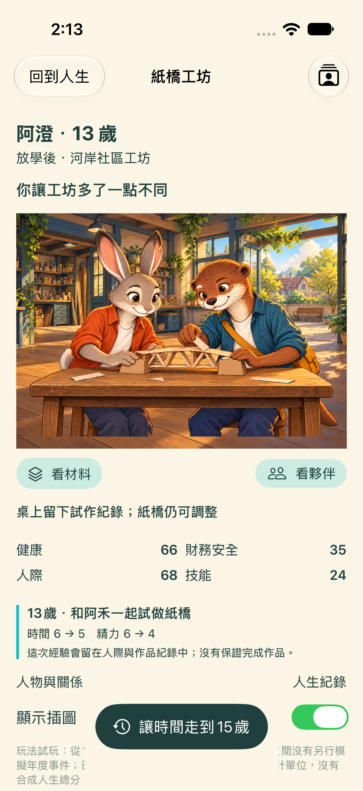
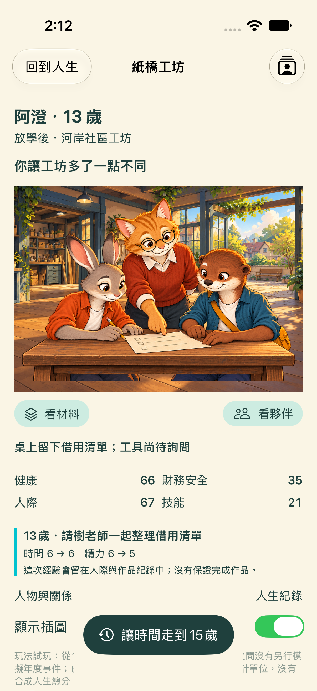
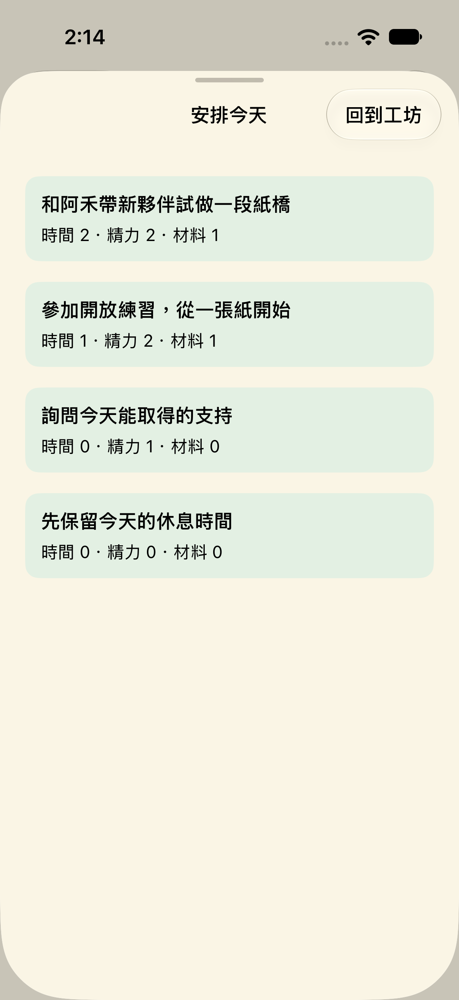
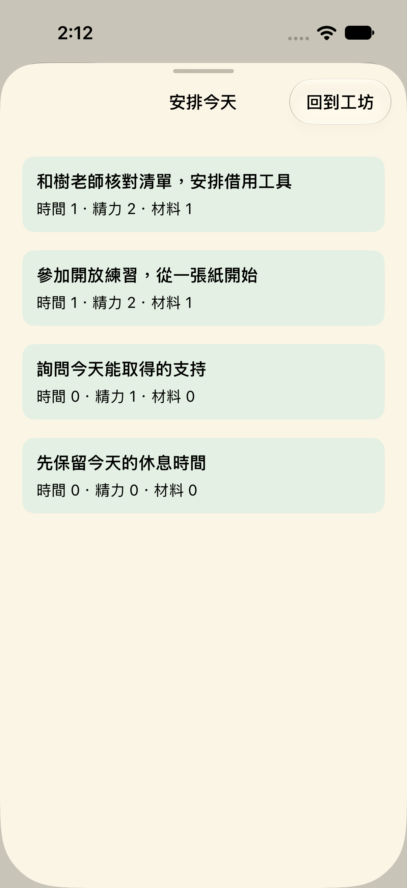
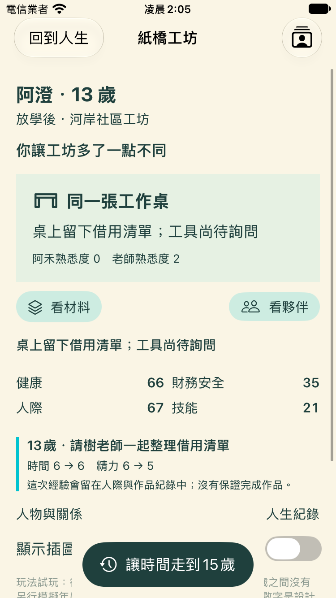
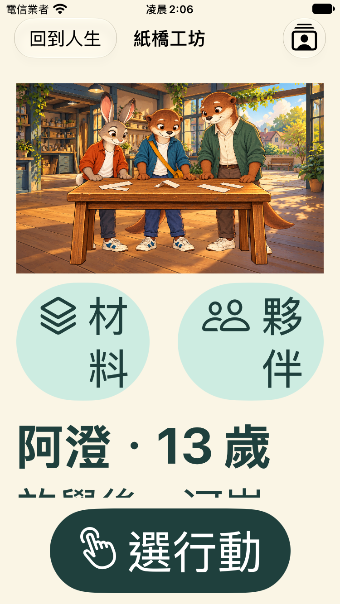
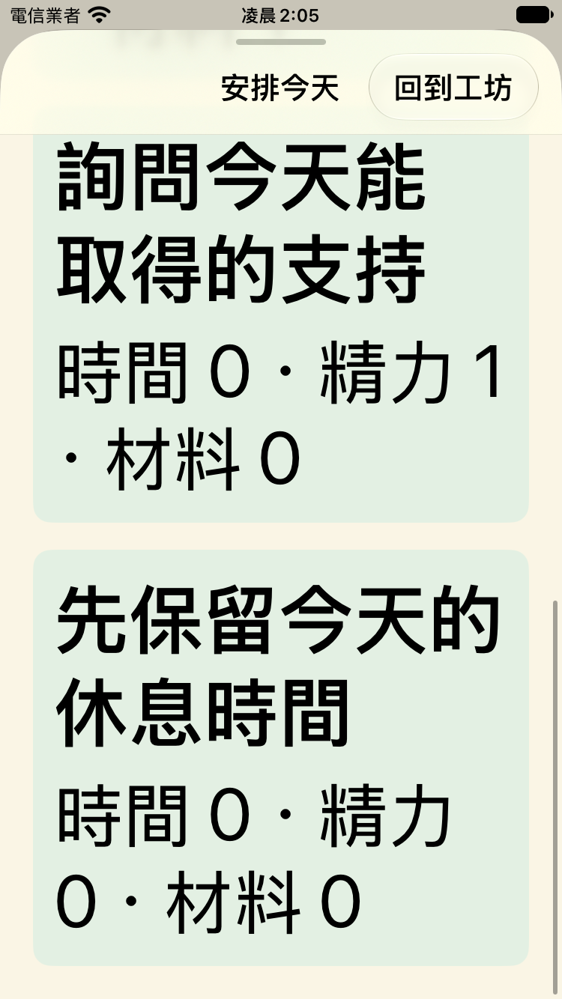
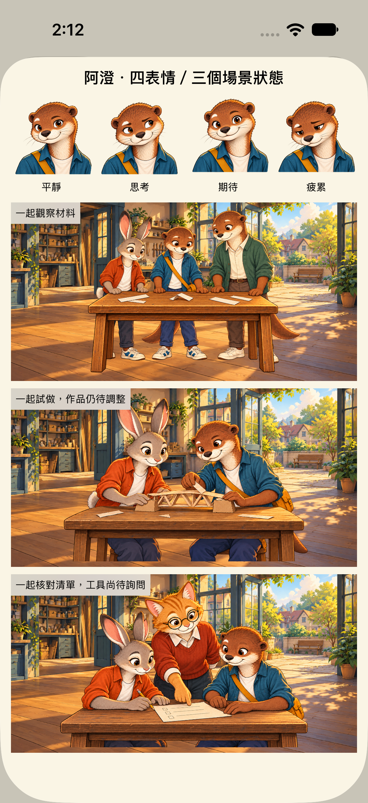

# 紙橋工坊 Gameplay／Simulation 候選圖庫

從13歲的行動留下經驗，再於15歲真正操作不同機會。先看[驗收紀錄](FINAL_REVIEW.md)及[規則／真人試玩標準](GAMEPLAY_SLICE.md)。工程、視覺候選及真人遊戲感分別判定。



## 同一間工坊，兩條人生經驗

|初始世界|一起試作之後|求助之後|
|---|---|---|
||||

|試作路線：15歲可陪同帶領|求助路線：15歲可核對借用|
|---|---|
|||

這兩個行動有不同ID、條件、成本、實際狀態效果及trace；不是同一個按鈕換文案。練習、求助與免費休息繼續存在。工具借用尚待確認，沒有憑空宣稱成功。

## 圖片關閉、小螢幕與最大字級

|插圖關閉仍可行動|SE 3最大字級首屏|最大字級最後一個免費選項|
|---|---|---|
||||

## 既有演出與歷史版本



上圖只驗證靜態演出圖錄，沒有新增表情或姿勢套件。GS-05只編修初始共同視線；素材仍是未正式核准的候選。

[歷史Visual Loop首頁](../../artifacts/simulation/before-visual-loop.png)來自舊分支`78cd44b`，屬於示範資料原型。它與本輪的共用引擎切片是不同來源版本；不要將舊測試或美術判定轉算成本輪成果。[來源與雜湊](../../artifacts/simulation/before-manifest.json)。

## 自己操作

開啟`LifeCrossroads.xcodeproj`，執行`LifeCrossroads` scheme，從首頁點「走進紙橋工坊」。先觀察、安排今天，再走到15歲。關閉插圖後可繼續相同行動；重新啟動保留進度；完成後可從同起點重試另一條路。此切片固定日本第一家庭、Seed 42。

原生SwiftUI Preview位於`LifeCrossroads/App/WorkshopWorldView.swift`，包含普通與最大字級。完整人生原型仍可由原首頁進入。

在已安裝本輪iOS 27 Simulator runtime的Mac可重跑：

```bash
swift test
python3 -m unittest discover -s tests -p 'test_*.py' -v
python3 artifacts/simulation/native-check-runner.py com.apple.CoreSimulator.SimDeviceType.iPhone-SE-3rd-generation local-se
python3 artifacts/simulation/native-check-runner.py com.apple.CoreSimulator.SimDeviceType.iPhone-17 local-standard
```

執行器每次建立專用裝置，成功／失敗／中斷都清理該裝置，並驗證UUID已不存在；不刪其他裝置或共用runtime。一般環境可使用既有`scripts/ios-check.sh`自動選取已安裝的配置。原始結果包保留本機`artifacts/ios/`，版本控制收錄摘要、截圖、實際JSON觀察與雜湊。
