# 紙橋工坊：三項P2修正圖庫

本輪延續 `codex/sim-workshop-continuity`；沒有增加角色圖或改動人生規則。[驗收與界線](FINAL_REVIEW.md)、[修正範圍／診斷](RECOVERY.md)、[上一輪圖庫](../REVIEW.md)。所有下圖均為本輪Simulator原生截圖，非重畫的示意圖。

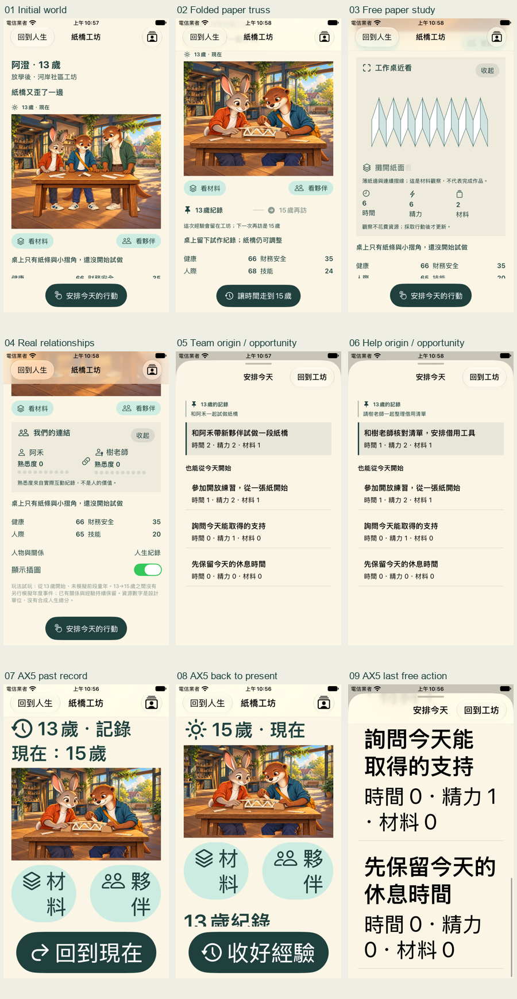

## 行動機會有前因與主次

|一起試作 → 15歲帶領機會|向老師求助 → 15歲借用機會|
|---|---|
|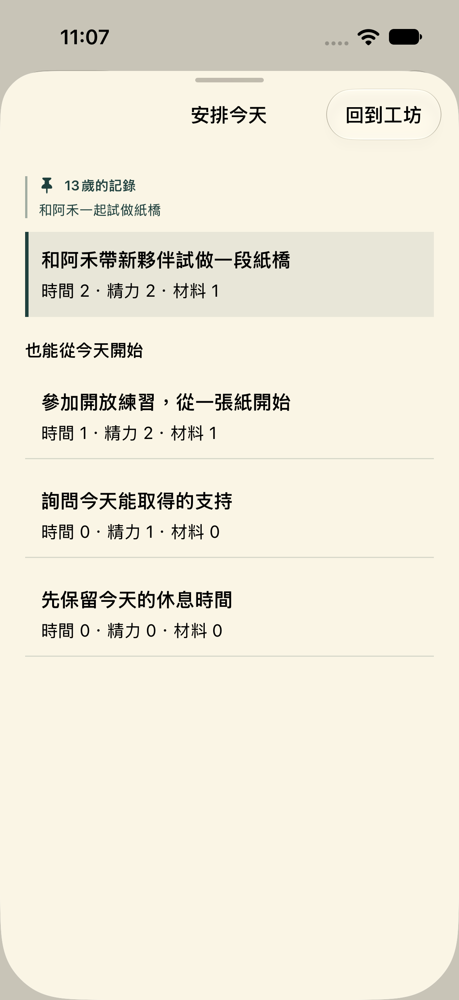|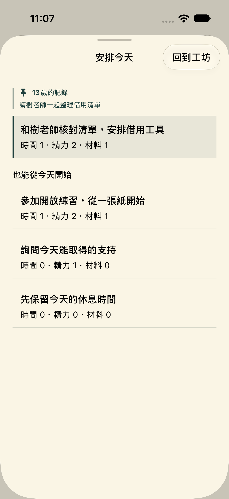|

13歲記錄取自真正的來源trace；專屬延續行動與一般練習、求助、休息採不同層級。選項、成本與可操作性都保留。

## 仍在同一間工坊觀察

|紙面與摺線|人物的實際連結|試作紙橋的薄紙摺邊|
|---|---|---|
|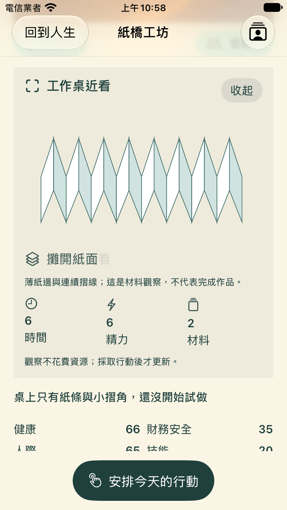|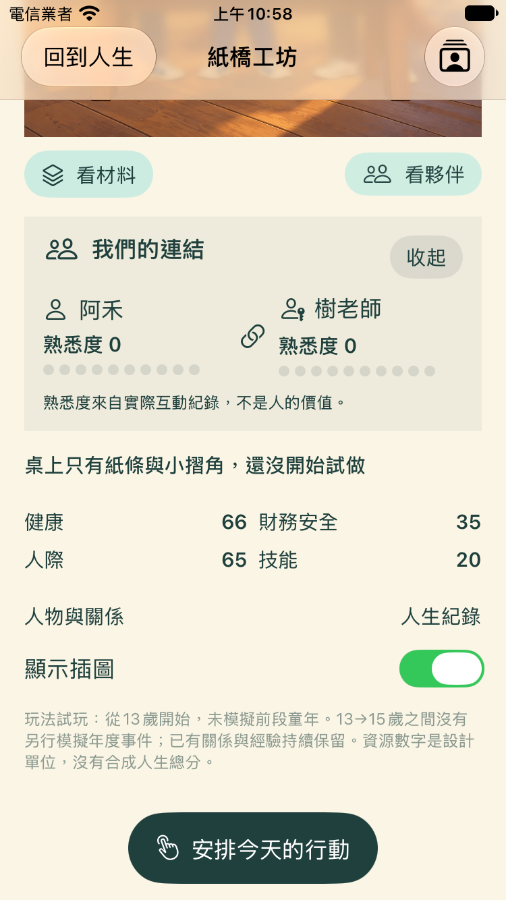|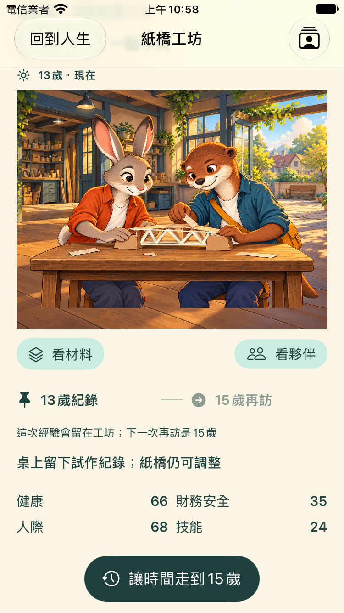|

這些觀察不花費資源。摺紙圖解是材料研究，不等於完成作品；紙橋薄邊由原生Canvas繪製，原有角色點陣圖保持相同。

## 回看過去，再回到現在

|最大字級／Reduce Motion：13歲紀錄|返回15歲現在|
|---|---|
|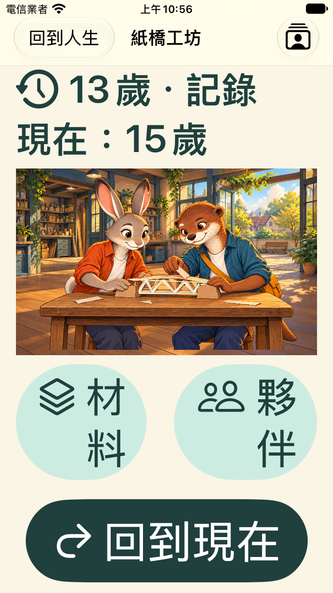|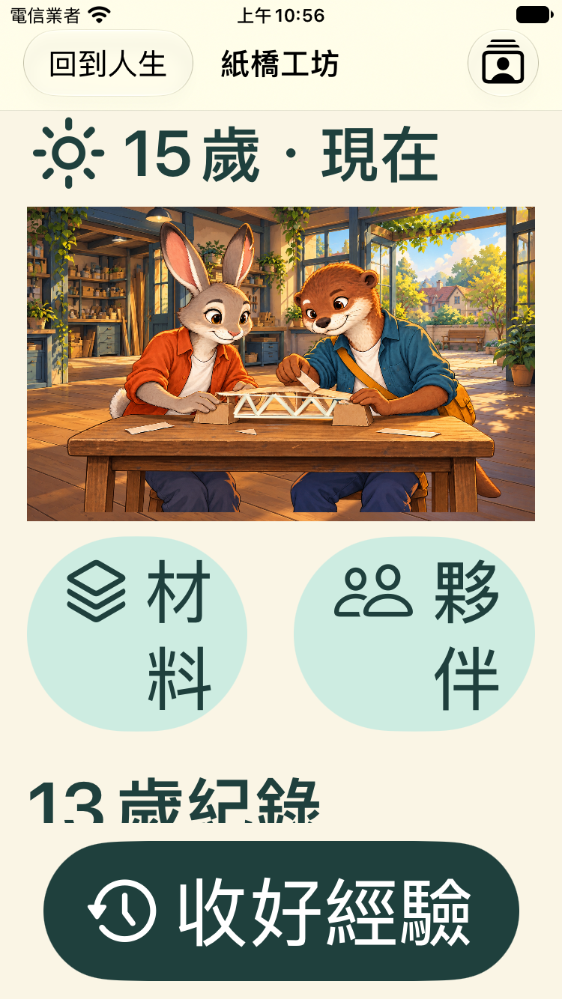|

回看使用13歲實際trace中的資源、人物及作品紀錄；返回保留整份LifeSession。年份、過去／現在與返回入口明確區分，過去不能執行今天的新行動。13→15歲仍是明示跳轉，中間年度未模擬；沒有宣稱完成連續年度人生世界。

## 雙機、大字與既有完整人生回歸

|iPhone 17首頁|SE 3最大字級首頁|最後免費行動完整捲出|
|---|---|---|
|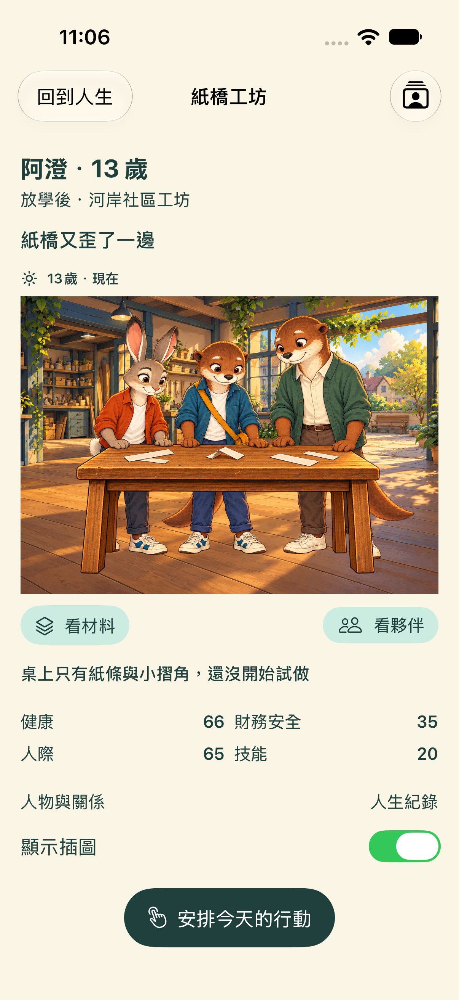|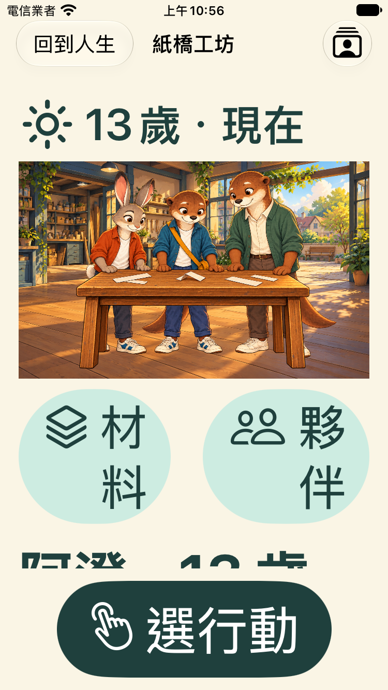|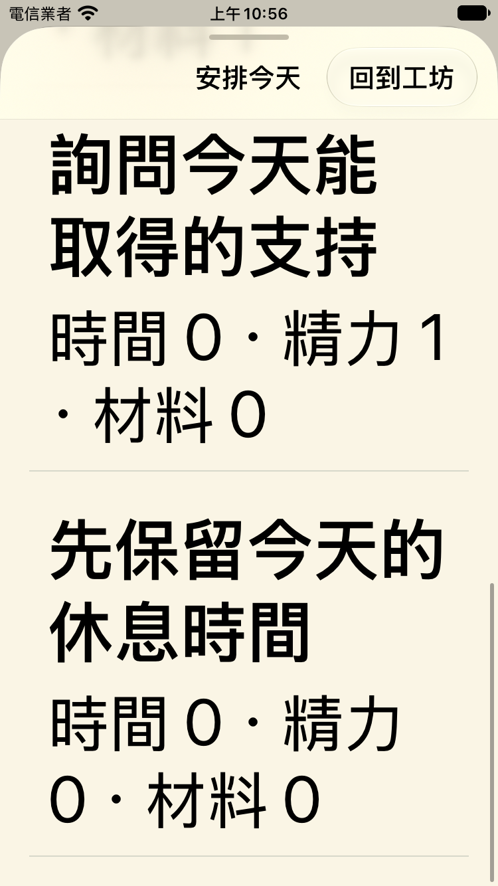|

每款機型保留原14項並新增3項，共17項。對應來源、摘要、附件雜湊及專用裝置刪除收據見驗收文件；實機、人工VoiceOver、兒少理解及重玩意願仍待驗證。

## 自己操作與重跑

在原生首頁選「走進紙橋工坊」，先看材料或夥伴，再安排今天。走到15歲後可看13歲紀錄、返回現在並繼續；原完整人生首頁仍可使用。

```bash
swift test
python3 -m unittest discover -s Tests -p 'test_*.py' -v
python3 artifacts/simulation-p2/native-check-runner.py com.apple.CoreSimulator.SimDeviceType.iPhone-SE-3rd-generation review-se
python3 artifacts/simulation-p2/native-check-runner.py com.apple.CoreSimulator.SimDeviceType.iPhone-17 review-standard
```

本機安裝的runtime為iOS 27；不是最低iOS17實測證據。執行器成功、失敗或中斷均刪除自己建立的裝置與資料，不刪共用runtime或其他裝置。原始`.xcresult`與診斷影片留在本機`artifacts/ios/`，版本控制保留摘要、截圖、JSON與雜湊。
