# UI-11／12 Review：選擇如何留下痕跡

獨立增量分支 `codex/ui-11-12-choice-feedback`，base `1771c57`（已接受的 Event-First v1）。
範圍為 UI-11 流程修正與 UI-12 示範表現；未合併 main，未接正式引擎，沒有新增 AI 圖片。

## 同一事件的兩條路

| 和朋友做簡易作品 | 先找老師想辦法 |
|---|---|
| 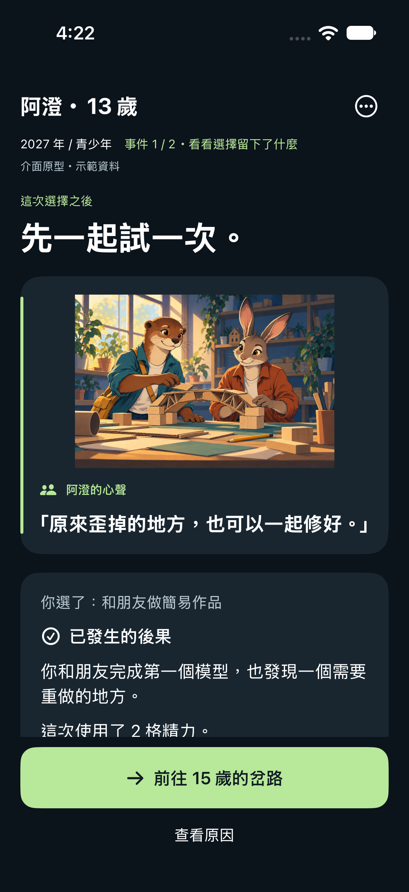 | 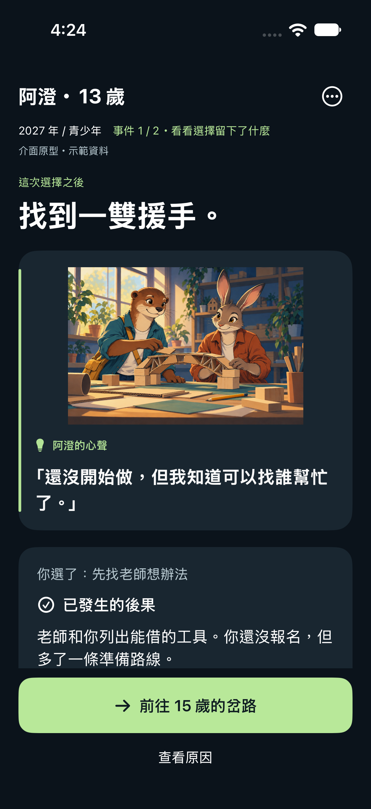 |
| 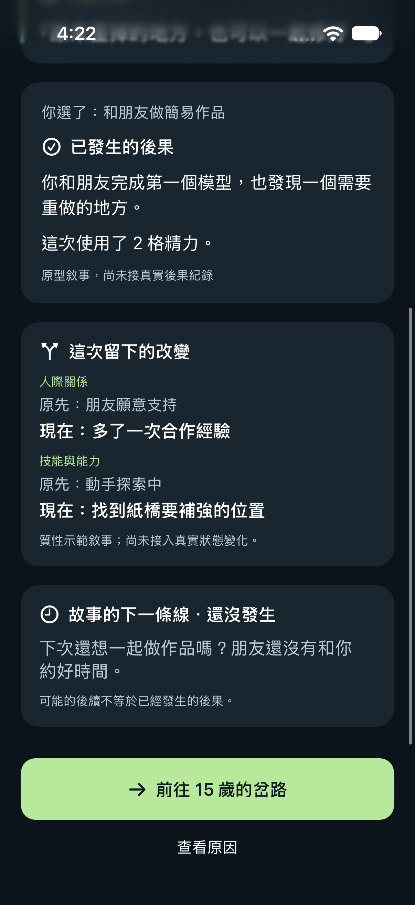 | 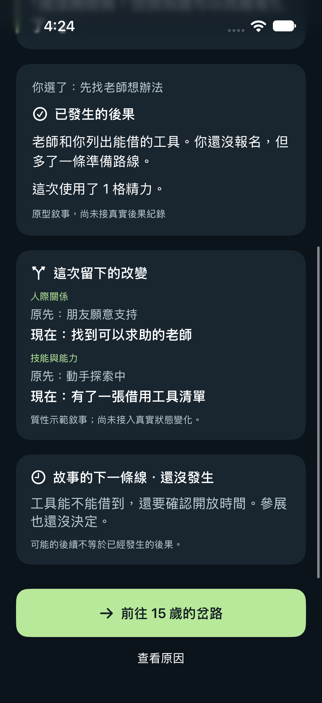 |
| 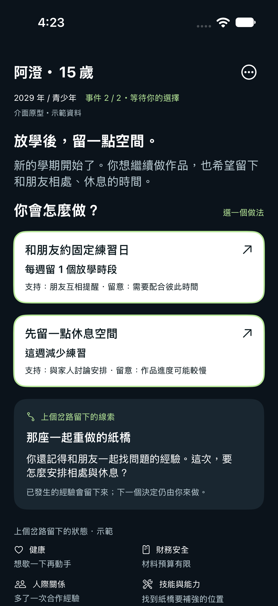 | 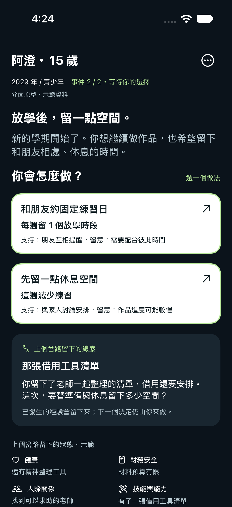 |

角色的心聲、質性前後變化與未發生的伏筆各自呈現。下一事件回提已做的選擇；狀態明示來自上個岔路。
目前都是編寫好的示範敘事，沒有新算資源數字、成功率或人生總分。兩條路都保留後續不確定性。

## 流程與審查修正

| 選項對應比較 | 實際人生節點 | 回顧完成狀態 |
|---|---|---|
| 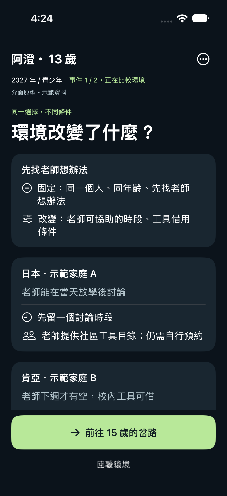 | 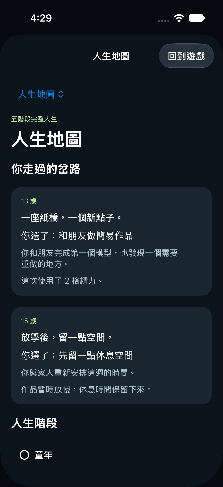 | 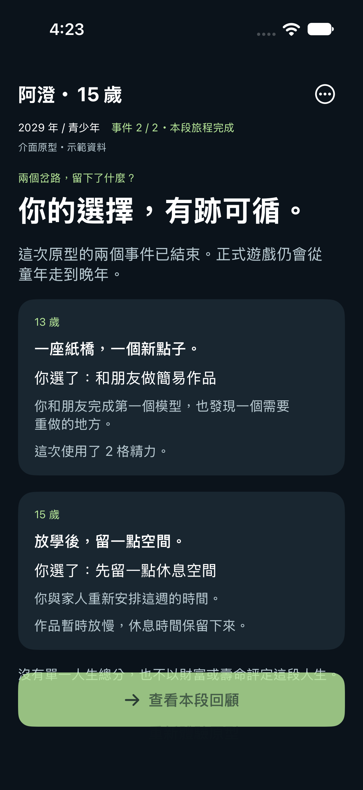 |

- 後果與比較同以 `eventID + optionID` 配對，並核對內容的 key；缺少／錯配不借用另一份結果。
- 頁首會顯示目前在決策、後果、原因、比較或回顧；主要按鈕明說下一個年齡或回顧。
- 地圖只列實際選過的節點；回看不新增紀錄，重玩清空。
- B／C 為 [章節線框](../../artifacts/ui-11-12/screenshots/standard/structure-novel.png)／[地圖線框](../../artifacts/ui-11-12/screenshots/standard/structure-map.png)，頂部與選項區都寫明不可操作，移除無作用按鈕。

## 窄螢幕與大字

| 正常文字的比較末段 | 最大文字的比較末段 |
|---|---|
| 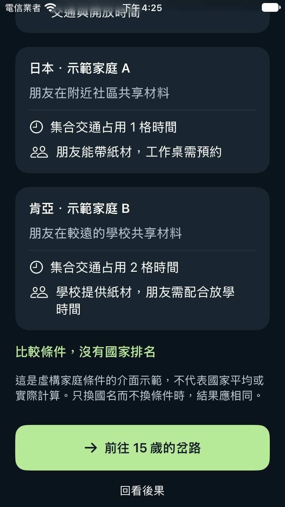 | 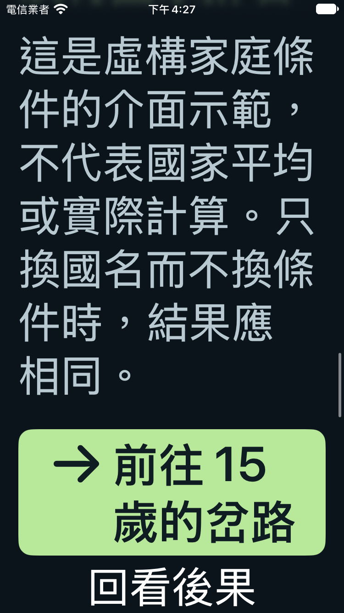 |

測試須確認最後一段的整個 frame 在頁尾按鈕上方、可見且下一步可點；只看到元素存在不足以算通過。
可執行入口：`UIPrototype/EventFirst.xcodeproj`，scheme `EventFirst`。
`bash tools/ui/check.sh --test --device-type iPhone-17 --result-bundle /tmp/event-first.xcresult` 跑基本檢查、既有 Swift 測試、原型狀態檢查與原生 UI 測試。
窄螢幕用 `--device-type iPhone-SE-3rd-generation`。每次建立暫用裝置，結束（含失敗）即刪除；xcresult 在裝置外保留。強制終止 Python／系統斷電可能略過 finally，屆時依輸出的精確 ID 補清理。

執行結果見 [驗證紀錄](../../artifacts/ui-11-12/verification.json)；[契約與固定腳本](ui-11-12.md)／[DTO](view-contract.md)。
UI-12 的「玩家能說出選擇造成什麼不同」仍待真人驗證；不能從這些截圖或自動測試宣稱已更好玩。
