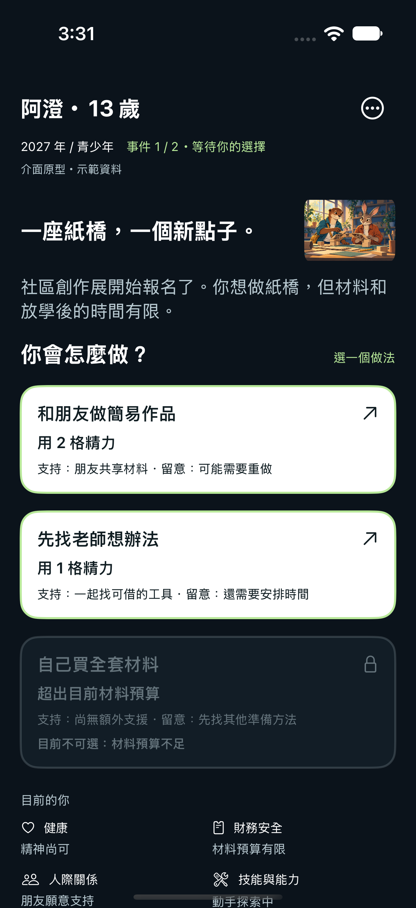
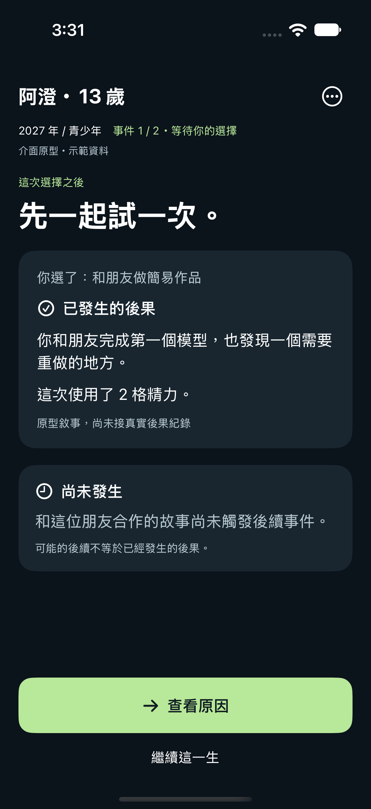
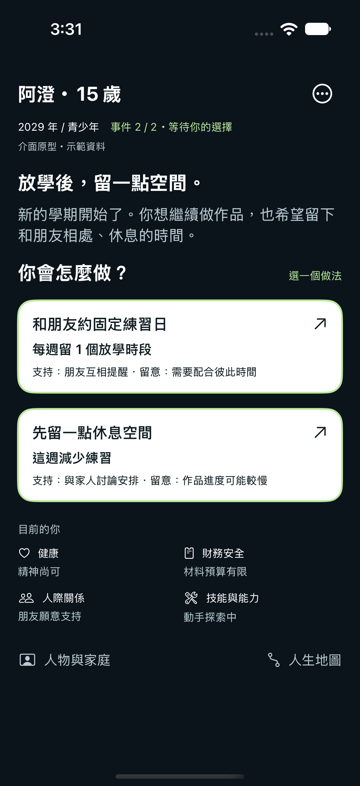
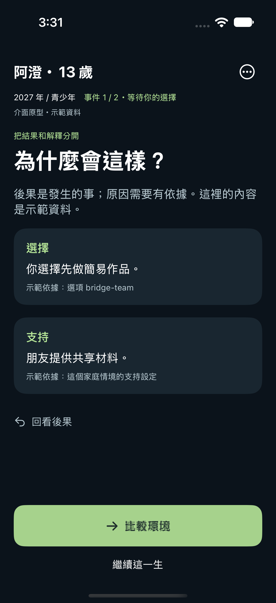
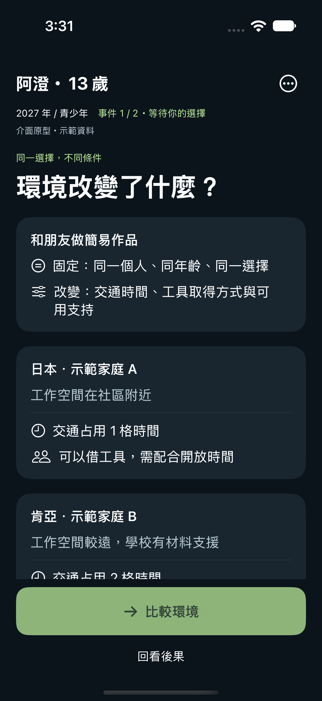
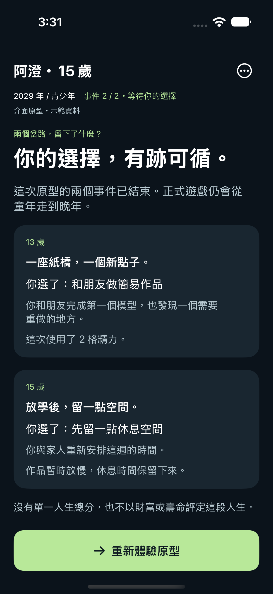
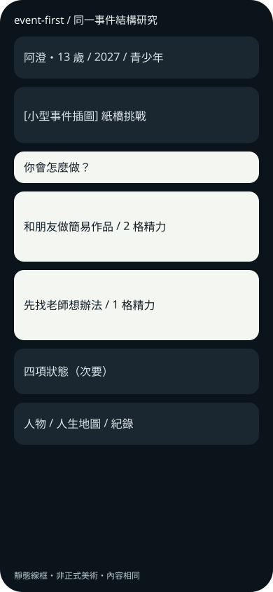
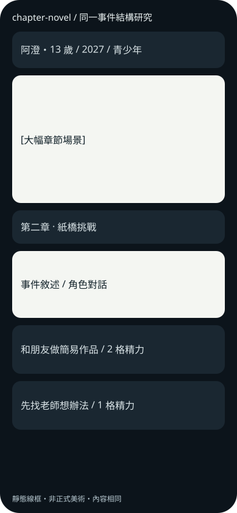
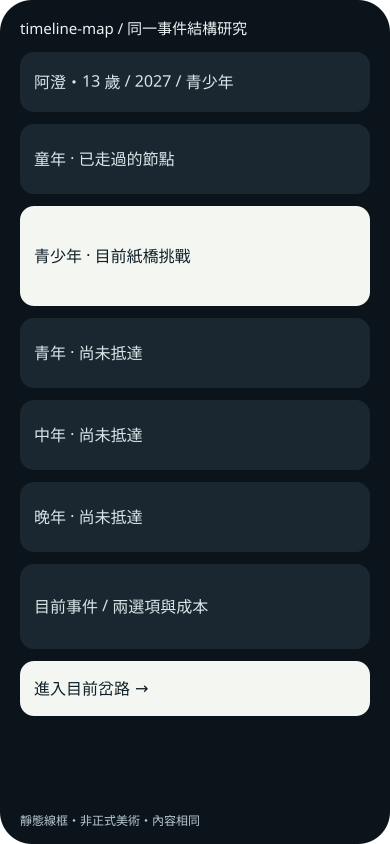

# 事件主導 UI / UX MVP Review

本輪優先 UI-00、UI-01、UI-02、UI-04、UI-06。預設主方向是事件卡主導；這是可跑的原型，仍待兒少理解/五秒測試與正式資料接線。

## 首頁 v1 與推進

| 事件首頁 | 已發生後果 | 下一事件 |
|---|---|---|
|  |  |  |

首頁縮小插圖與人物資訊，選項直接列成本/支持/不確定性；第三選項以明確理由顯示不可選。
13 歲事件選擇後，可看原因與比較，再進到 15 歲事件。年齡/年份來自 fixture，UI 沒有自行模擬人生。

| 原因頁 | 條件比較 | 原型回顧 |
|---|---|---|
|  |  |  |

後果與原因分頁；未發生的呼應單獨標示；比較固定/變動條件，並明示虛構家庭資料，沒有國家排名。

## 三方向結構研究

三版均使用 13 歲紙橋事件，不能把它們當三套已完成遊戲模式。

| A 事件卡主導 | B 章節敘事 | C 人生時間軸 |
|---|---|---|
|  |  |  |

原生研究畫面：[章節型](../../artifacts/ui/screenshots/standard/structure-novel.png)、[時間軸型](../../artifacts/ui/screenshots/standard/structure-map.png)。

## 小螢幕與資料空缺

[窄螢幕首頁](../../artifacts/ui/screenshots/narrow/01-home-event-first.png) · [最大文字第二選項](../../artifacts/ui/screenshots/narrow/maximum-type-second-choice.png) · [缺原因紀錄](../../artifacts/ui/screenshots/standard/missing-trace.png)

可執行原型：`UIPrototype/EventFirst.xcodeproj` / `EventFirst` scheme。
Preview：`UIPrototype/EventFirst/EventFirstView.swift`。
[驗收與未驗項](acceptance.md) · [首頁規格](home-v1.md) · [DTO 草案](view-contract.md) · [全部 Slices](SLICES.md)

本輪沒有改人生引擎、國家資料或正式素材審核，也沒有以兩個事件取代 LC-02 四國完整人生。
