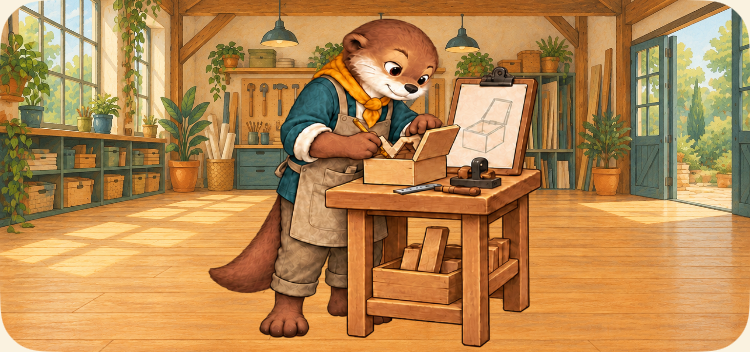
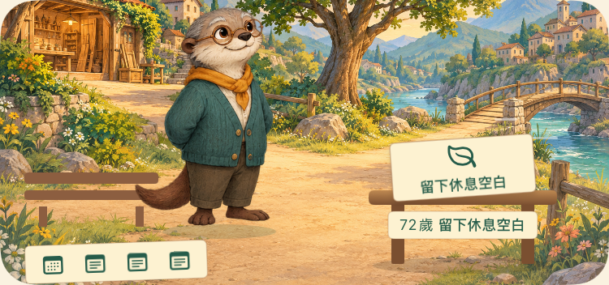

# Before / After — 真實原生場景

同一份正式引擎存檔、Seed與已選紀錄。左為81371e0原場景加拍攝入口，右為最終Round3；不是mockup。圖為XCTest原生場景元素截圖，完整手機畫面連結在每列下方。基準年長場景仍有文字，不列入無文字盲評。

[來源及圖檔SHA](../../artifacts/evidence/visual-loop-02/verification.json) · [拍攝方法](REPRODUCE.md)

## 13歲：線上創作

| 真實路線 | Before · SE3 | After · SE3 |
| --- | --- | --- |
| 13-online |  |  |

完整畫面：[13-online](../../artifacts/evidence/visual-loop-02/round3/iPhone-SE-3rd-generation/13-online-normal-screen.png)

## 13歲：紙本練習

| 真實路線 | Before · SE3 | After · SE3 |
| --- | --- | --- |
| 13-paper |  |  |

完整畫面：[13-paper](../../artifacts/evidence/visual-loop-02/round3/iPhone-SE-3rd-generation/13-paper-normal-screen.png)

## 13歲：提出求助

| 真實路線 | Before · SE3 | After · SE3 |
| --- | --- | --- |
| 13-ask |  |  |

完整畫面：[13-ask](../../artifacts/evidence/visual-loop-02/round3/iPhone-SE-3rd-generation/13-ask-normal-screen.png)

## 13歲：保留休息

| 真實路線 | Before · SE3 | After · SE3 |
| --- | --- | --- |
| 13-rest |  |  |

完整畫面：[13-rest](../../artifacts/evidence/visual-loop-02/round3/iPhone-SE-3rd-generation/13-rest-normal-screen.png)

## 17歲：遠距與備料共作

| 真實路線 | Before · SE3 | After · SE3 |
| --- | --- | --- |
| 17-remote |  |  |
| 17-collective |  |  |

完整畫面：[17-remote](../../artifacts/evidence/visual-loop-02/round3/iPhone-SE-3rd-generation/17-remote-normal-screen.png) · [17-collective](../../artifacts/evidence/visual-loop-02/round3/iPhone-SE-3rd-generation/17-collective-normal-screen.png)

## 25歲：試作與在地製作桌

| 真實路線 | Before · SE3 | After · SE3 |
| --- | --- | --- |
| 25-remote |  |  |
| 25-collective |  |  |

完整畫面：[25-remote](../../artifacts/evidence/visual-loop-02/round3/iPhone-SE-3rd-generation/25-remote-normal-screen.png) · [25-collective](../../artifacts/evidence/visual-loop-02/round3/iPhone-SE-3rd-generation/25-collective-normal-screen.png)

## 32歲：保留空間與實際參與

| 真實路線 | Before · SE3 | After · SE3 |
| --- | --- | --- |
| 32-prepared |  |  |
| 32-participating |  |  |

完整畫面：[32-prepared](../../artifacts/evidence/visual-loop-02/round3/iPhone-SE-3rd-generation/32-prepared-normal-screen.png) · [32-participating](../../artifacts/evidence/visual-loop-02/round3/iPhone-SE-3rd-generation/32-participating-normal-screen.png)

## 年齡與選擇前連續性

| 真實路線 | Before · SE3 | After · SE3 |
| --- | --- | --- |
| 08-arrival |  |  |
| 13-before |  |  |
| 65-arrival |  |  |
| 80-arrival |  |  |

完整畫面：[08-arrival](../../artifacts/evidence/visual-loop-02/round3/iPhone-SE-3rd-generation/08-arrival-normal-screen.png) · [13-before](../../artifacts/evidence/visual-loop-02/round3/iPhone-SE-3rd-generation/13-before-normal-screen.png) · [65-arrival](../../artifacts/evidence/visual-loop-02/round3/iPhone-SE-3rd-generation/65-arrival-normal-screen.png) · [80-arrival](../../artifacts/evidence/visual-loop-02/round3/iPhone-SE-3rd-generation/80-arrival-normal-screen.png)

## 兩尺寸／大字／減少動態

最終每台30種實際狀態：normal14、large8、reduced8。每種另有完整畫面和原生scene crop。這是2個capture XCTest中的60次狀態檢查，不混稱正式30個UI案例。

[SE3全部原生圖與SHA](../../artifacts/evidence/visual-loop-02/round3/iPhone-SE-3rd-generation/screenshots.json) · [iPhone17全部原生圖與SHA](../../artifacts/evidence/visual-loop-02/round3/iPhone-17/screenshots.json)

[SE最大字級遠距](../../artifacts/evidence/visual-loop-02/round3/iPhone-SE-3rd-generation/17-remote-large-screen.png) · [標準最大字級遠距](../../artifacts/evidence/visual-loop-02/round3/iPhone-17/17-remote-large-screen.png)

這些差異表示已發生的活動，不表示收入、獲選、作品完成或真實國家優劣。13與17的精確年齡仍不能只靠圖可靠判斷；真人娛樂性與正式選稿另待驗收。
