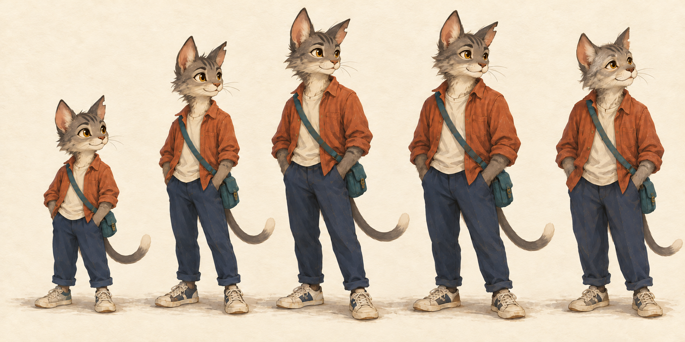
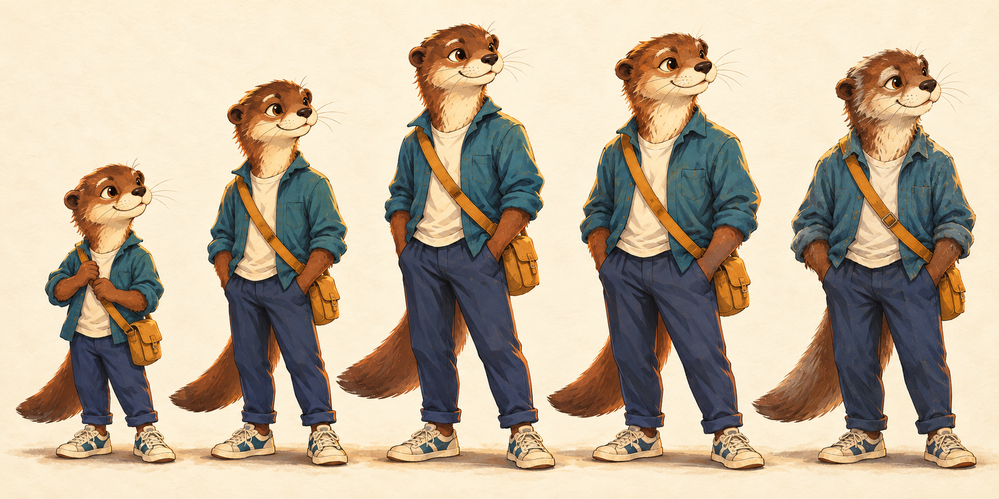
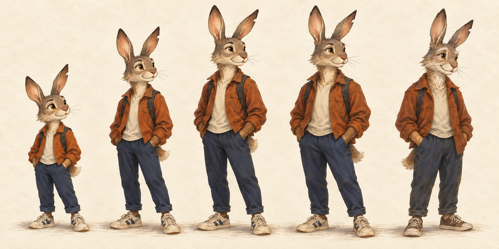
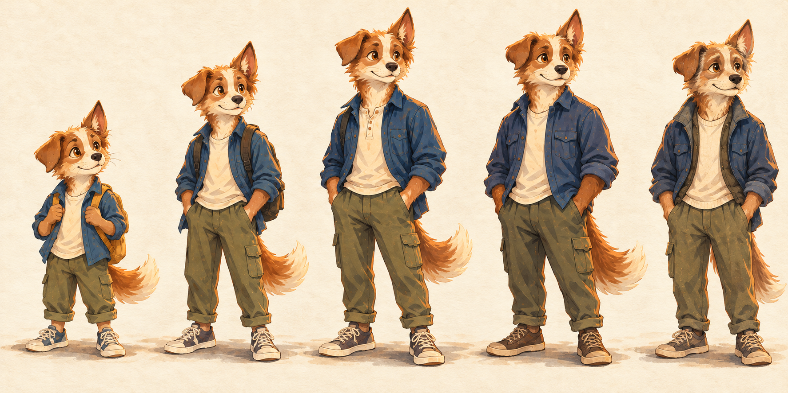
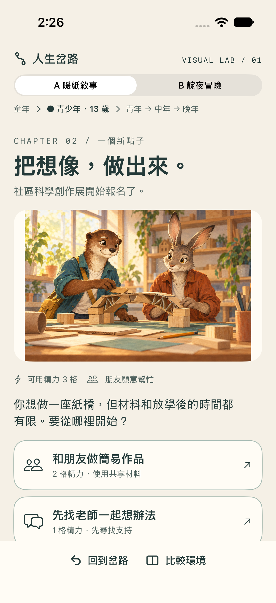
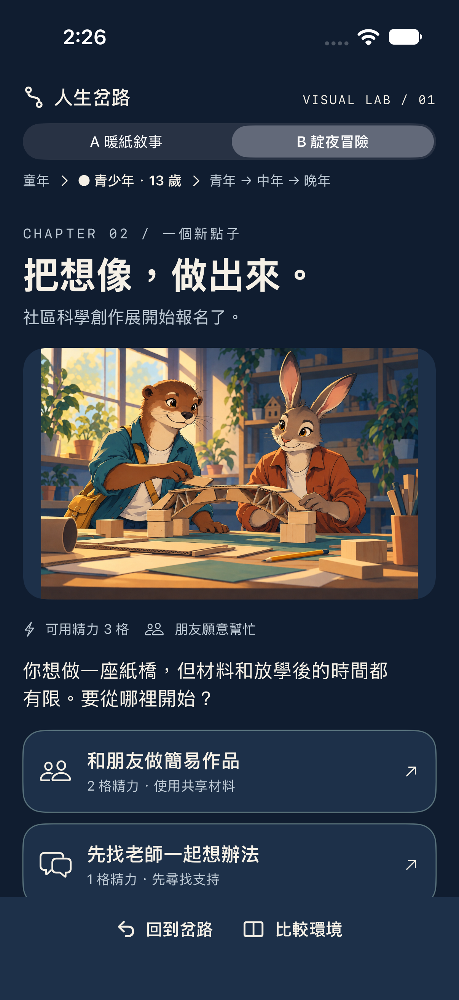
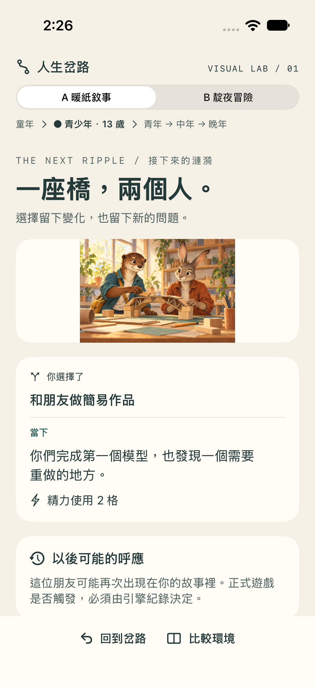
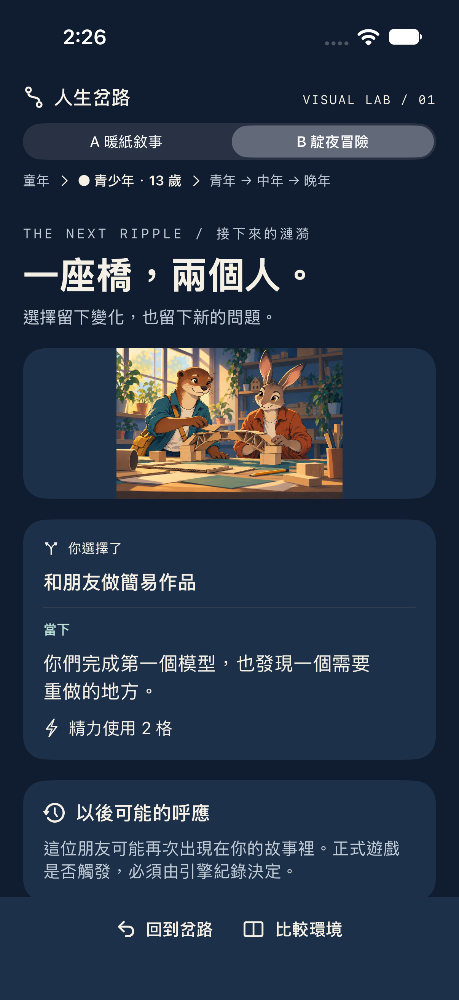

# 視覺候選檢視索引

2026-10-23 · 內建 ImageGen · 候選稿，未核准為正式素材。

每張左至右：**童年 → 青少年 → 青年 → 中年 → 晚年**。

## 貓咪（修正版）

## 水獺

## 野兔

## 犬

## 同事件手機原型

原生 SwiftUI / iPhone 17 Simulator；文案、選項與 viewport 相同。

| A 暖紙敘事 | B 靛夜冒險 |
|---|---|
|  |  |
|  |  |

完整截圖另含原因、比較、缺原因與放大文字，位於 `artifacts/visual/screenshots/`。
互動與 `#Preview` 原始碼位於 `UIPrototype/VisualPreview.xcodeproj`。

[已驗與待驗](acceptance.md) · [工具與授權](TOOL-RESEARCH.md) · [全部 prompt](../../assets/prompts/)
