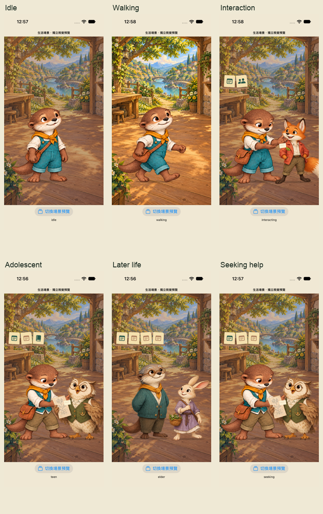

# WORLD-ART-01 原生預覽圖庫

這是獨立 Visual World 預覽 App，沒有取代正式人生流程。UI 是 SwiftUI 原生輸出；背景、透明角色與經歷物件分層，不是整張 AI 手機 mockup。

最終來源：iPhone 17 `standard-20261024T045200Z`、SE 3 `narrow-20261024T045202Z`；各五項 UI 測試通過。兩輪 component／harness／素材／契約 SHA 相同，詳見 [validation.json](../../artifacts/world-art/validation.json)。

| 畫面 | iPhone 17 | iPhone SE 3 |
| --- | --- | --- |
| 待機 | [原圖](../../artifacts/world-art/gallery/standard/01-idle.png) | [原圖](../../artifacts/world-art/gallery/narrow/01-idle.png) |
| 移動／晚光 | [原圖](../../artifacts/world-art/gallery/standard/02-walking.png) | [原圖](../../artifacts/world-art/gallery/narrow/02-walking.png) |
| 朋友互動／生活物件 | [原圖](../../artifacts/world-art/gallery/standard/03-interacting.png) | [原圖](../../artifacts/world-art/gallery/narrow/03-interacting.png) |
| 點閱真實紀錄來源 | [原圖](../../artifacts/world-art/gallery/standard/04-source.png) | [原圖](../../artifacts/world-art/gallery/narrow/04-source.png) |
| 青少年紙本經驗 | [原圖](../../artifacts/world-art/gallery/standard/05-teen.png) | [原圖](../../artifacts/world-art/gallery/narrow/05-teen.png) |
| 晚年沿用原有造型 | [原圖](../../artifacts/world-art/gallery/standard/06-elder.png) | [原圖](../../artifacts/world-art/gallery/narrow/06-elder.png) |
| 最大文字／角色保留 | [原圖](../../artifacts/world-art/gallery/standard/07-largest.png) | [原圖](../../artifacts/world-art/gallery/narrow/07-largest.png) |
| 減少動態／保留移動姿勢 | [原圖](../../artifacts/world-art/gallery/standard/08-reduced-motion-walking.png) | [原圖](../../artifacts/world-art/gallery/narrow/08-reduced-motion-walking.png) |
| 詢問，不假裝已完成 | [原圖](../../artifacts/world-art/gallery/standard/09-seeking.png) | [原圖](../../artifacts/world-art/gallery/narrow/09-seeking.png) |
| 暫停／原場景保留 | [原圖](../../artifacts/world-art/gallery/standard/10-paused.png) | [原圖](../../artifacts/world-art/gallery/narrow/10-paused.png) |

每張圖的原始測試、附件與 SHA 見兩個 gallery 目錄下的 `source-map.json`。測試包與全部影片／UI dump 保留本機 build 目錄，不把巨大診斷檔案推進 Git。失敗／中止的歷史摘要與清理收據仍保留，沒有把舊圖算成最終版。

這些照片不能證明實機操作、正式遊戲接線、完整人生節奏或兒少重玩意願。步行目前是單姿勢位移；成年以後的完整動作尚未製作。素材仍是供選稿的候選。
